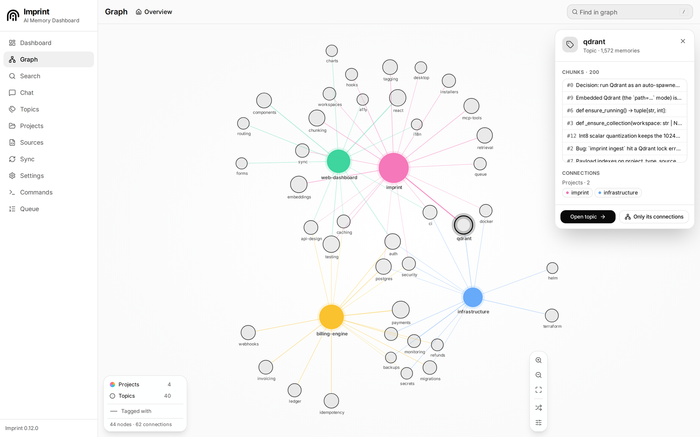
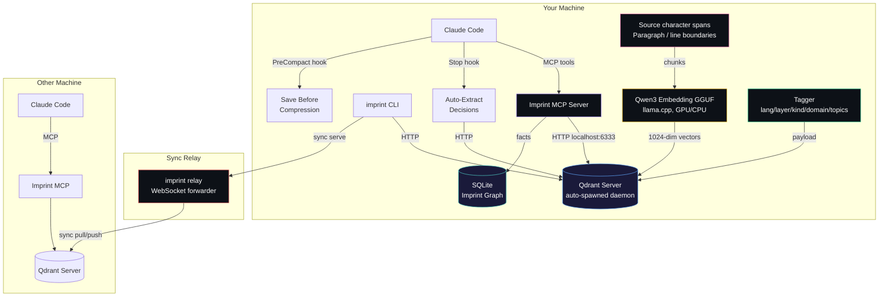

<p align="center">
  
</p>

<h1 align="center">Imprint</h1>

<p align="center">
  <strong>Persistent memory for AI coding tools. 100% local. Zero API cost.</strong>
</p>

<p align="center">
  Give Claude Code, Cursor, Codex CLI, Copilot, and Cline a long-term memory.<br/>
  Stop re-explaining your codebase every session.
</p>

<p align="center">
  <a href="https://imprintmcp.alexandruleca.com"><strong>imprintmcp.alexandruleca.com →</strong></a>
</p>

<p align="center">
  <a href="https://github.com/alexandruleca/imprint-memory-layer/actions/workflows/ci.yml"></a>
  <a href="https://github.com/alexandruleca/imprint-memory-layer/releases/latest"></a>
  <a href="LICENSE"></a>
  
</p>

---



### Why Imprint

- **Remembers what your AI forgets.** Decisions, patterns, bug fixes, and architectural choices persist across sessions — searched semantically, not grepped.
- **Measured usage and visible trade-offs.** Published retrieval, token, estimated cost and latency measurements include paired trial evidence, failures, exact model/corpus versions and uncertainty. See [BENCHMARK.md](BENCHMARK.md).
- **Runs 100% locally by default.** Qwen3-Embedding-0.6B via llama.cpp, Qdrant vector DB, verifiable source chunking — all on your machine. No API credits consumed unless you opt in.
- **One command, any host.** Wires into Claude Code, Cursor, Codex CLI, Copilot, or Cline via MCP. Same memory, shared across tools.

**Runs 100% locally. Zero API credits consumed by default.** Everything from embeddings, chunking, tagging, vector search, and the knowledge graph — runs on your machine:

- **Embeddings**: Qwen3-Embedding-0.6B (Qwen's Q8_0 GGUF) via llama.cpp, no network calls, no per-token cost. It runs on a GPU of any vendor through llama.cpp's Vulkan or Metal build when one is found, with no CUDA, and on the CPU otherwise; the local LLM uses the same GPU.
- **Vector store**: Qdrant auto-spawned as a local daemon on `127.0.0.1:6333`. Your data never leaves the box unless you sync it to another device.
- **Chunking**: Contiguous source spans with bounded overlap and complete redacted source snapshots. [Coverage and reconstruction](docs/source-memory.md).
- **Tagging**: deterministic rules + zero-shot cosine similarity against pre-embedded labels. A local LLM call per chunk if you want it, run in the background so `learn` and `ingest` finish once memories are searchable.
- **Imprint graph**: SQLite on disk for temporal facts.
- **Secret redaction**: API keys, tokens, private keys and assigned passwords become `[REDACTED:<kind>:<length>]` before anything is stored, embedded, synced or sent to a tagging or summary model. A scrub on one device reaches every synced device. OpenAI Privacy Filter can be added as an opt-in local model. See [secret redaction](docs/redaction.md).

The ingestion flow: scan dir → detect project → chunk files → tag (lang/layer/kind/domain/topics) → redact secrets → embed chunks → upsert into Qdrant. A Stop hook auto-extracts decisions from Claude transcripts; a PreCompact hook saves context before window compression. Search goes straight to the local vector DB — no round-trip to any provider.

**Optional cloud LLM tagging** is opt-in only (`imprint config set tagger.llm true`) if you want more granular topics and are fine spending credits. Providers: Anthropic, OpenAI, Gemini, or fully-local Ollama / vLLM. Leave it off and nothing ever talks to a paid API.



## Quick Install

**Linux / macOS:**
```bash
curl -fsSL https://raw.githubusercontent.com/alexandruleca/imprint-memory-layer/main/install.sh | bash
```

**Windows (PowerShell):**
```powershell
irm https://raw.githubusercontent.com/alexandruleca/imprint-memory-layer/main/install.ps1 | iex
```

Pin a specific version, pick the dev channel, or use prebuilt Docker images — see [docs/installation.md](docs/installation.md).

## Updating

Once installed, use the built-in updater — no curl, no sudo. `data/` (workspaces, Qdrant storage, SQLite graphs, config, `profile.json`) and `.venv/` are always preserved; only the code tree is replaced.

```bash
imprint update              # latest stable, asks for confirmation
imprint update --dev        # latest dev build (a dev prerelease, or stable once it is newer)
imprint update --version v0.3.1
imprint update --check      # show current + latest release and exit
imprint update -y           # skip confirmation (CI / scripts)
```

Re-running `install.sh` also works and now prompts before overwriting an existing install. For non-interactive upgrades pass `--yes` or set `IMPRINT_ASSUME_YES=1`.

**Embeddings and the local LLM use a GPU** of any vendor when llama.cpp finds one (`model.device`, default `auto`), through its Vulkan or Metal build; no CUDA is installed. An update that changes the embedding model needs a reindex into a new workspace; see [embeddings and rebuilding](docs/embeddings.md#rebuild-after-upgrading).

## Supported hosts

`imprint setup <target>` auto-wires the MCP server into each supported AI coding tool. Run `imprint setup all` to configure every host that's installed on your machine; missing tools are skipped with a warning, not an error.

| Target        | Wired into                                         | Config file                                                                           | Enforcement         |
|---------------|-----------------------------------------------------|----------------------------------------------------------------------------------------|---------------------|
| `claude-code` | Claude Code CLI (MCP + hooks + global `CLAUDE.md`) | `~/.claude/settings.json` + MCP registered via `claude mcp add`                        | Hard (PreToolUse)   |
| `cursor`      | Cursor IDE (MCP + always-on rule)                  | `~/.cursor/mcp.json` + `~/.cursor/rules/imprint.mdc`                                   | Text-only (rule)    |
| `codex`       | OpenAI Codex CLI                                   | `~/.codex/config.toml` (`[mcp_servers.imprint]`)                                       | Text-only           |
| `copilot`     | GitHub Copilot — VS Code (1.143+), Copilot CLI, JetBrains | `~/.copilot/mcp-config.json` + `copilot-instructions.md` + `hooks/imprint.json` (honors `COPILOT_HOME`) | Instructions + SessionStart/Stop hooks |
| `cline`       | Cline 4 — VS Code extension and forks, CLI, JetBrains, desktop | `~/.cline/data/settings/cline_mcp_settings.json` + `~/.cline/rules/imprint.md` (honors `CLINE_DIR`, `CLINE_DATA_DIR`, `CLINE_MCP_SETTINGS_PATH`) | Text-only (rule) |

`imprint disable` is symmetric — it tears down the MCP entry from every config file above that still exists (the venv and data are always preserved so re-enabling is fast).

To rehook or unhook clients without touching the runtime or its services, use `imprint connect [client]` and `imprint disconnect [client]` (default: all clients); `imprint clients` shows which are connected. The dashboard's **Commands** page offers them as Connect clients and Disconnect clients.

## Commands

```bash
imprint setup [target]     # install deps, register MCP, configure the chosen host tool
                           #   target: claude-code (default) | cursor | codex | copilot | cline | all
imprint update [--version v0.3.1] [--dev] [-y] [--check]
                           # install the latest release the way this install was set up; preserves data/ and .venv/
imprint uninstall [-y] [--keep-data]
                           # disconnect clients, stop Imprint, remove runtime + memories (--keep-data keeps them)
imprint status             # is everything wired? show enabled/disabled, server pid, memory stats
imprint enable [target]    # re-wire MCP + hooks + start server
                           #   target: claude-code | claude-desktop | chatgpt-desktop | cursor | codex | copilot | cline | openclaw | all
imprint disable            # disconnect managed clients, strip hooks/rules, stop services (data preserved)
imprint clients [--json]   # clients Imprint connects to, and whether each is connected
imprint connect [client]   # register the installed runtime with clients (MCP + hooks + rules); installs and starts nothing
imprint disconnect [client]  # unregister clients, incl. their recorded WSL profiles; stops nothing
imprint ingest <path>      # index project source files (directory or single file)
imprint learn              # index Claude Code, Codex, Cursor, Copilot + Cline conversations (incl. WSL profiles) + memory files
imprint learn --desktop    # also ingest Claude Desktop / ChatGPT Desktop export zips from Downloads
imprint ingest-url <url>   # fetch URL(s), extract content, and index (html/pdf/etc)
imprint refresh <dir>      # re-index only changed files (SHA256-based)
imprint refresh-urls       # re-check stored URLs via ETag/Last-Modified and re-index changed
imprint retag [--project] [--all]
                           # re-run the tagger on existing memories (--all re-tags already-tagged chunks)
imprint retag --pending    # tag now what learn/ingest left for background LLM tagging
imprint scrub [--workspace <name>] [--apply]
                           # count secrets stored before redaction existed; --apply redacts and re-embeds them
# Heavy jobs (ingest/refresh/retag/scrub/ingest-url/refresh-urls) serialize via a
# shared queue lock. If another job is already running, the CLI hands its job to
# the dashboard's queue (an identical waiting job absorbs it) or waits; with
# IMPRINT_QUEUE_NO_WAIT=1 it exits nonzero. Background LLM tagging steps aside.
imprint migrate --from WS1 --to WS2 --project NAME | --topic TAG | --source KEY [--copy] [--dry-run]
                           # move memories between workspaces (preserves vectors);
                           # --copy keeps the source, e.g. to curate a workspace to share
imprint move <project> <target> [--source KEY]... [--apply]
                           # preview moving a project (or some of its sources) to another project;
                           # --apply moves them and keeps later refresh/learn/sync writes there
imprint config             # show all settings with current values
imprint config set <k> <v> # persist a setting (e.g. model.name, qdrant.port)
imprint config get <key>   # show one setting with source + default
imprint config reset <key> # remove override, revert to default
imprint server <cmd>       # manage the local Qdrant daemon: start | stop | status | log
imprint workspace          # list workspaces and show active
imprint workspace switch <name>  # switch to workspace (creates if new)
imprint workspace delete <name>  # delete a workspace and its data
imprint workspace use [name]     # make this project use a workspace (writes .imprint/workspace.json)
imprint wipe [--force]     # wipe active workspace
imprint wipe --all         # wipe everything (all workspaces)
imprint sync serve [--relay <host>] [--workspace <name>] [--send-only | --receive-only]
                           # expose one workspace for encrypted peer sync; add --remember on BOTH sides to pair
imprint sync <code> [--workspace <name>] [--two-way | --send-only] [--fresh]
                           # join with that code; receives only unless --two-way/--send-only (confirmed before sending)
imprint sync watch          # auto-sync explicitly paired devices while this process runs
imprint sync peers          # list pairings; enable/disable/forget <pair-id> controls them
imprint sync remove <pair-id>   # drop a pairing on this device only, now (its device is gone)
imprint sync export | import <dir>       # snapshot bundle; import re-embeds only memories it scrubs
imprint relay              # run the sync relay server
imprint ui [start|stop|status|open|restart|log|runtime] [--port N]
                           # dashboard (FastAPI + Next.js); bare `imprint ui` runs foreground;
                           # `runtime` prints the paths the desktop app serves, as JSON
imprint version            # print version
```

## Documentation

| Topic | File |
|---|---|
| Install, versioning, channels, Docker | [docs/installation.md](docs/installation.md) |
| Components, data flow, Qdrant daemon, lifecycle | [docs/architecture.md](docs/architecture.md) |
| Embedding pipeline + GPU acceleration | [docs/embeddings.md](docs/embeddings.md) |
| Chunking strategy + tunables | [docs/chunking.md](docs/chunking.md) |
| Metadata tags, LLM providers, search filters | [docs/tagging.md](docs/tagging.md) |
| Workspaces + project detection | [docs/workspaces.md](docs/workspaces.md) |
| MCP tools + automatic updates | [docs/mcp.md](docs/mcp.md) |
| Peer sync, relay server, dashboard | [docs/sync.md](docs/sync.md) |
| Secret redaction, Privacy Filter, `imprint scrub` | [docs/redaction.md](docs/redaction.md) |
| Command queue + cancellation | [docs/queue.md](docs/queue.md) |
| All settings (`imprint config`) | [docs/configuration.md](docs/configuration.md) |
| Building from source + CI/release flow | [docs/building.md](docs/building.md) |
| Benchmark evidence & methodology | [BENCHMARK.md](BENCHMARK.md) |

## Glossary

Terms used across the docs.

| Term | Definition |
|---|---|
| **Chunk** | A sub-file unit of text (a function, class, markdown section, conversation turn) that gets its own embedding vector. Produced by the chunker. |
| **Embedding** | Dense numeric vector (default 1024-dim) representing the semantic meaning of a chunk. Similar meanings → nearby vectors. |
| **Qdrant** | The vector database that stores embeddings + payloads. Runs as an auto-spawned local daemon on `127.0.0.1:6333`. |
| **Collection** | Qdrant's term for a named set of vectors. Each workspace has its own collection (e.g. `memories`, `memories_research`). |
| **Workspace** | Isolated memory environment — dedicated Qdrant collection + SQLite DB + WAL. Lets you separate research/staging/prod memories. |
| **Imprint Graph** | Temporal fact store (SQLite) for structured `subject → predicate → object` facts with `valid_from` / `ended` timestamps. |
| **MCP** | Model Context Protocol — the open protocol Claude Code uses to call external tools. Imprint ships an MCP server with 19 tools — see [docs/mcp.md](docs/mcp.md). |
| **Project** | A codebase identified by a canonical name from its manifest (`package.json`, `go.mod`, etc.). Projects get the same identity across machines even if paths differ. |
| **Layer** | Path-derived tag: `api`, `ui`, `tests`, `infra`, `config`, `migrations`, `docs`, `scripts`, `cli`. |
| **Kind** | Filename-derived tag: `source`, `test`, `migration`, `readme`, `types`, `module`, `qa`, `auto-extract`. |
| **Domain** | Content-derived tag from keyword regex: `auth`, `db`, `api`, `math`, `rendering`, `ui`, `testing`, `infra`, `ml`, `perf`, `security`, `build`, `payments`. |
| **Topics** | Free-form tags from zero-shot cosine similarity or (opt-in) LLM classification — more granular than `domain`. |
| **Ingestion** | Scanning a directory, detecting projects, chunking files, embedding chunks, tagging, and upserting into Qdrant. |
| **Refresh** | Incremental re-ingest — compares byte hashes, reuses unchanged sources and removes recorded deleted files inside selected roots. |
| **Queue** | Single-slot FIFO (`data/queue.sqlite3` + `data/queue.lock`) that serializes ingest/refresh/retag/ingest-url so parallel runs can't OOM the box. Identical waiting jobs merge, and background LLM tagging runs only when nothing else waits. UI at `/queue` lists active + queued + background tagging + history; cancel propagates SIGTERM→SIGKILL to the subprocess's process group, so in-flight LLM tagger calls die with it. See [docs/queue.md](docs/queue.md). |
| **Auto-extract** | Stop hook that parses conversation transcripts after each Claude response and stores readable messages, available analysis and tool evidence with role metadata. |
| **PreCompact hook** | Synchronous hook that fires before Claude's context window compresses — instructs Claude to save important context via MCP tools first. |
| **Relay server** | Stateless WebSocket forwarder (`imprint relay`) that brokers peer sync between two machines. Sessions are end-to-end encrypted with the one-time share code (SPAKE2 + AES-256-GCM), so the relay sees only room IDs, IP addresses and the sizes and timing of ciphertext — never the code's PIN, devices or memories. Synced records carry content, metadata and precomputed vectors, so both sides need the same embedding profile — see [docs/sync.md](docs/sync.md#end-to-end-encryption). |
| **WAL** | Write-ahead log — append-only `wal.jsonl` per workspace, used for replay / recovery of memory operations. |
| **Zero-shot tagging** | Classifying chunks by cosine similarity against pre-embedded label prototypes — no per-chunk LLM call. |
| **Dev / stable channel** | Two release tracks from one pipeline. Dev = prerelease of the next stable version on each releasable `dev` push (`vX.Y.Z-dev.N`); `--dev` installs the highest version, prerelease or stable. Stable = conventional-commit release on `main` merges (`vX.Y.Z`). See [ADR 0066](docs/adr/0066-dev-prereleases-from-the-dev-branch.md). |

## Benchmarks

Imprint measures local retrieval separately from Claude Code task usage. Both ON and OFF receive the same frozen public source files and synthetic historical evidence; ON adds read-only memory tools and memory-first guidance with file fallback. Trials use fresh sessions, counterbalanced paired order and recorded model IDs.

The [current measured report](BENCHMARK.md) includes actual paired token/cost totals, per-task medians, latency, source recall/MRR/nDCG, failures and bootstrap intervals. [Versioned sanitized trials](benchmark/published/) support recalculation; [the run selector](benchmark/latest.json) drives the website directly from JSON. [Methodology and limitations](docs/benchmarks.md) explain why the old Imprint 0.5.1 figures and biased quality judge are retired. No universal token saving or answer-quality uplift is claimed.

```bash
PYTHON=/path/to/venv/bin/python bash benchmark/run.sh --runs 5 --workers 2
```

## Roadmap

- [ ] Local Auto Back-up
- [ ] External Qdrant Instance instead of local db
- [ ] BackUp/Sync to another Qdrant Remote Instance Server
- [x] Document (pdf, doc, odt, ...etc) ingestion capability
- [ ] Video / Audio ingestion capability
- [x] URL ingestion capability

## License

Imprint is licensed under the [Apache License 2.0](LICENSE).

Third-party dependencies retain their own licenses — see [THIRD_PARTY_LICENSES.md](THIRD_PARTY_LICENSES.md) for the full table.

**Default models:** [Qwen3-Embedding-0.6B](https://huggingface.co/Qwen/Qwen3-Embedding-0.6B) for retrieval and optional [Qwen3.5-4B](https://huggingface.co/Qwen/Qwen3.5-4B) for tags, summaries and dashboard tools declare Apache-2.0. Imprint downloads pinned GGUF artifacts on demand. See [embeddings and rebuilding](docs/embeddings.md) and [local helper configuration](docs/local-models.md). Existing indexes require explicit rebuilding; an upgrade does not erase memories.

## Contact

Questions, feedback, or bug reports? Reach out:

[](https://x.com/AlexandruLeca)
[](https://github.com/alexandruleca/imprint-memory-layer/issues)

Engineering documentation: [documentation index](docs/README.md), [architecture](docs/architecture.md), [integration strategy](docs/integrations.md), [platform validation](docs/platform-validation.md), and [architecture decisions](docs/adr/README.md).
