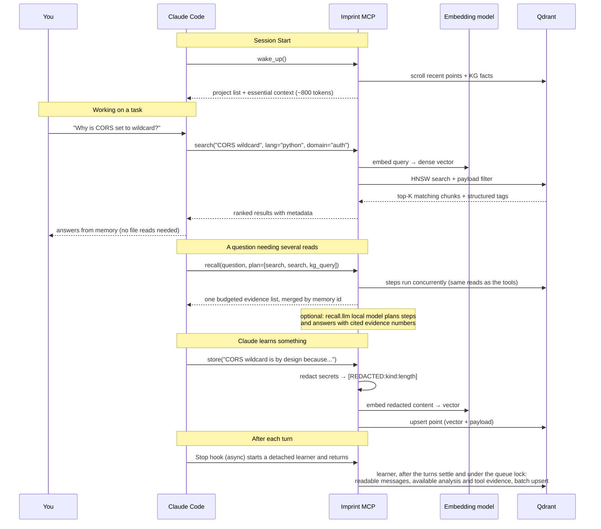
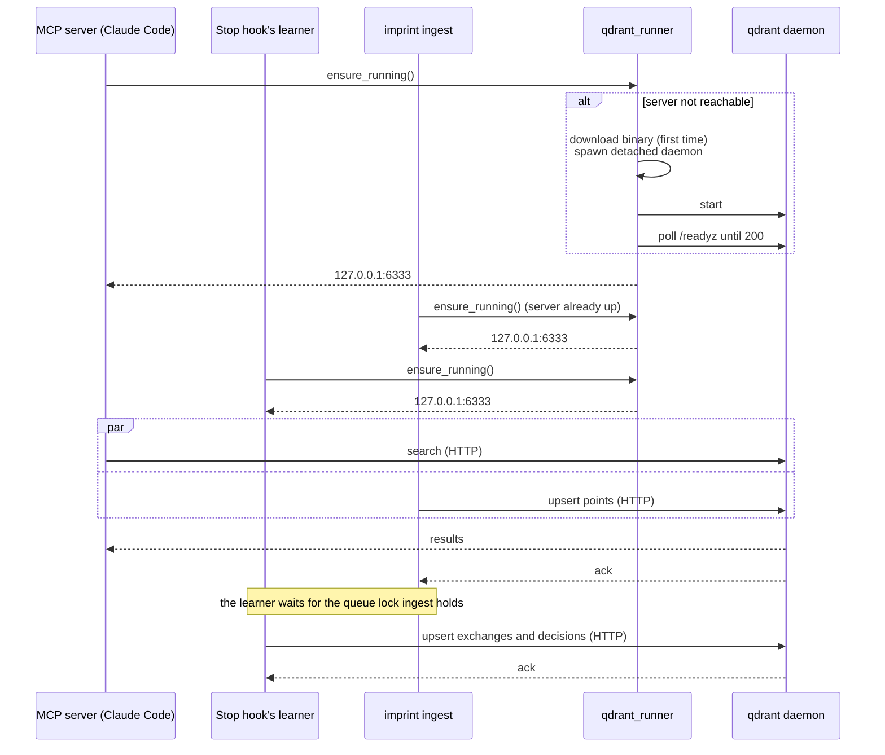

## Components

```mermaid
graph LR
    subgraph "Go CLI (imprint binary)"
        SETUP[setup]
        STATUS[status]
        ENABLE[enable / disable]
        INGEST[ingest]
        REFRESH[refresh]
        RETAG[retag]
        SCRUB[scrub]
        IURL[ingest-url]
        SERVER[server start/stop]
        SYNC[sync]
        RELAY[relay]
        UI[ui]
    end

    subgraph "Python (imprint/)"
        MCP[FastMCP Server<br/><small>17 tools</small>]
        VS[vectorstore.py<br/><small>Qdrant HTTP client</small>]
        RED[redaction.py<br/><small>secrets → placeholders</small>]
        QR[qdrant_runner.py<br/><small>auto-spawn daemon</small>]
        EMB[embeddings.py<br/><small>llama.cpp, GPU/CPU</small>]
        KG[imprint_graph.py<br/><small>SQLite facts</small>]
        CHK[chunker.py<br/><small>Contiguous source spans</small>]
        TAG[tagger.py<br/><small>4-source metadata</small>]
        CLS[classifier.py<br/><small>type detection</small>]
        PRJ[projects.py<br/><small>manifest detection</small>]
        QUEUE[queue.py<br/><small>single-slot FIFO<br/>+ dispatcher + cancel</small>]
        API[api.py<br/><small>FastAPI dashboard</small>]
    end

    subgraph "Daemon"
        QSRV[(Qdrant server<br/>127.0.0.1:6333)]
    end

    subgraph "Storage (data/)"
        QSTORE[qdrant_storage/<br/><small>vectors + payload</small>]
        SQLITE[(SQLite<br/>facts per workspace)]
        WAL[wal.jsonl<br/><small>WAL per workspace</small>]
        WSCFG[workspace.json<br/><small>active + known</small>]
        PROTO[label_prototypes.npy<br/><small>zero-shot cache</small>]
        QBIN[qdrant-bin/<br/><small>downloaded binary</small>]
        QDB[(queue.sqlite3<br/>+ queue.lock)]
    end

    MCP --> VS --> QSRV --> QSTORE
    MCP --> KG --> SQLITE
    VS --> RED
    KG --> RED
    RED -.opt-in.-> PF[privacy_filter.py<br/><small>ONNX, CPU</small>]
    VS --> QR
    QR --> QBIN
    QR --> QSRV
    VS --> EMB
    VS --> WAL
    INGEST --> QUEUE
    REFRESH --> QUEUE
    RETAG --> QUEUE
    SCRUB --> QUEUE
    IURL --> QUEUE
    UI --> API --> QUEUE
    QUEUE --> QDB
    QUEUE --> CHK --> EMB
    QUEUE --> TAG
    TAG --zero-shot--> EMB
    TAG --zero-shot--> PROTO
    TAG -.LLM opt-in.-> LLM_API[LLM API<br/><small>anthropic/openai/<br/>ollama/vllm/gemini</small>]
    MCP -.recall.llm, local only.-> LOCAL_LLM[Local model<br/><small>llama.cpp, or loopback<br/>ollama/vllm</small>]
    INGEST --> PRJ
    SERVER --> QR

    style QSRV fill:#1a1a3a,stroke:#60a5fa,color:#fff
    style QSTORE fill:#1a1a3a,stroke:#60a5fa,color:#fff
    style SQLITE fill:#1a1a3a,stroke:#4ecdc4,color:#fff
    style MCP fill:#0d1117,stroke:#a78bfa,color:#fff
    style EMB fill:#0d1117,stroke:#fbbf24,color:#fff
    style CHK fill:#0d1117,stroke:#f472b6,color:#fff
    style TAG fill:#0d1117,stroke:#34d399,color:#fff
    style QR fill:#0d1117,stroke:#ff6b6b,color:#fff
    style LLM_API fill:#0d1117,stroke:#fbbf24,color:#fff,stroke-dasharray: 5 5
    style LOCAL_LLM fill:#0d1117,stroke:#fbbf24,color:#fff,stroke-dasharray: 5 5
```

| Component | Technology | Purpose |
|---|---|---|
| Vector store | Qdrant server (auto-spawned daemon) | HNSW + int8 scalar quantization, payload-indexed filters, multi-client safe ([ADR 0063](adr/0063-auto-spawned-local-qdrant-server.md)); replaced LanceDB ([ADR 0065](adr/0065-qdrant-over-lancedb-as-the-vector-store.md)) |
| Server runner | `qdrant_runner.py` | Downloads + spawns + supervises the local Qdrant daemon |
| Embeddings | Qwen3-Embedding-0.6B via llama.cpp | 1024-dim, 2048 runtime ctx, pinned Q8_0 GGUF. Runs whole on one GPU when llama.cpp finds one (Vulkan or Metal, no CUDA; `llama_runtime.py`), else on the CPU ([ADR 0086](adr/0086-embeddings-run-on-llama-cpp-without-cuda.md), [ADR 0087](adr/0087-llama-cpp-runs-each-model-on-one-gpu.md)). See [embeddings](embeddings.md) for rebuilding. |
| Chunking | Source character spans | Paragraph/line cuts, bounded overlap and exact redacted-source reconstruction; [source memory](source-memory.md) |
| Metadata tagger | Python | Deterministic + keyword dict + zero-shot (default) + opt-in multi-provider LLM |
| Source memory | SQLite + zlib | Complete redacted readable sources and versioned span manifests, published after vector replacement. [Read and verify](source-memory.md). |
| Imprint graph | SQLite | Temporal facts with valid_from/ended |
| Redaction | `redaction.py` + opt-in `privacy_filter.py` | Every memory and fact write, and every tagger or summarizer prompt, replaces credentials with `[REDACTED:<kind>:<length>]` before IDs and embeddings are computed or a model sees the text: deterministic rules always, OpenAI Privacy Filter's secret and account-number spans when `redact.privacy_filter` is on. Sync imports are redacted on arrival, and each write keeps the most redacted version of a memory, so one `imprint scrub` reaches every synced device. See [secret redaction](redaction.md) and [ADR 0060](adr/0060-redact-secrets-before-memories-are-stored.md). |
| MCP server | FastMCP (Python) | 19 tools — `search`/`get_memory`/`neighbors`/`graph_scope`/`list_sources`/`file_summary`/`file_chunks`/`read_source`/`device_context` for reads, `recall` for several reads in one call, `store`/`delete`/`ingest_url`/`ingest_content`/`purge_sources` for writes, `kg_query`/`kg_edit` for facts, `status` for stats and `use_workspace` for binding. Connects to Qdrant via HTTP. See [MCP tools](mcp.md). |
| CLI | Go | `setup`, `status`, `enable`, `disable`, `update`, `uninstall`, `ingest`, `learn`, `ingest-url`, `refresh`, `refresh-urls`, `retag`, `scrub`, `migrate`, `server`, `workspace`, `wipe`, `sync`, `relay`, `ui`, `config` |
| Relay | Go (nhooyr/websocket) | Stateless WebSocket forwarder for P2P sync; sees only ciphertext |
| Peer sync | `imprint/sync_ws.py` + `imprint/sync_crypto.py` | The one sync implementation, used by `imprint sync` (`imprint/cli_sync.py`) and the dashboard. End-to-end encrypted: SPAKE2 from the PIN in the one-time share code, then AES-256-GCM per direction. Joining receives only unless the user opts in and confirms the receiving device. See [sync](sync.md). |
| Command queue | `imprint/queue.py` + `imprint/queue_lock.py` + `internal/queuelock` | Single-slot FIFO (SQLite at `data/queue.sqlite3`, advisory flock at `data/queue.lock`). Serializes heavy jobs across the Go CLI and the FastAPI dispatcher; cancel sends SIGTERM → SIGKILL (3s) to the subprocess process group. See [queue.md](queue.md) and [ADR 0064](adr/0064-single-slot-command-queue-and-shared-lock.md). |

## Data Flow



## Concurrency: Auto-Spawned Local Server

Every Imprint process — MCP servers, hooks, CLI commands and the dashboard — uses one **auto-spawned local Qdrant server** on `127.0.0.1:6333`, started by the first process that needs it. Embedded mode would admit one process at a time; the reasoning, rejected alternatives and the conditions for revisiting it are in [ADR 0063](adr/0063-auto-spawned-local-qdrant-server.md).



[`qdrant_runner.py`](../imprint/qdrant_runner.py) handles the lifecycle:

- **First call**: downloads the pinned Qdrant binary (v1.17.1: a 28–35 MB download that unpacks to 96 MB on Linux x64 and 83 MB on Windows x64; [ADR 0063](adr/0063-auto-spawned-local-qdrant-server.md) records its measured memory) from GitHub releases into `data/qdrant-bin/`, then `subprocess.Popen([..., start_new_session=True])` so the daemon survives the parent process. Logs to `data/qdrant.log`, PID written to `data/qdrant.pid`.
- **Subsequent calls**: cheap HTTP probe to `/readyz` — returns immediately if alive.
- **Storage**: `data/qdrant_storage/` (collection data) + `data/qdrant_snapshots/`. Both gitignored.
- **Network**: managed HTTP/gRPC bind only to loopback; nonlocal auto-spawn settings fail before probing/downloading. Cluster mode and browser CORS are explicitly disabled, including when inherited Qdrant environment settings enable them. See [ADR 0024](adr/0024-enforce-local-service-boundaries.md).
- **Shutdown**: `imprint server stop` (or `imprint disable`) sends SIGTERM via the PID file.

| Env var | Default | Purpose |
|---|---|---|
| `IMPRINT_QDRANT_HOST` | `127.0.0.1` | Bind / connect host |
| `IMPRINT_QDRANT_PORT` | `6333` | HTTP port |
| `IMPRINT_QDRANT_GRPC_PORT` | `6334` | gRPC port |
| `IMPRINT_QDRANT_VERSION` | `v1.17.1` | Pinned release tag |
| `IMPRINT_QDRANT_BIN` | (auto) | Override binary path (e.g. system-installed qdrant) |
| `IMPRINT_QDRANT_NO_SPAWN` | `0` | Set `1` to disable auto-spawn — connect to your own managed server |

**Bring your own server**: set `IMPRINT_QDRANT_NO_SPAWN=1` and point `IMPRINT_QDRANT_HOST` at a separately managed Qdrant. For local Docker, publish `docker run -p 127.0.0.1:6333:6333 qdrant/qdrant`. Remote server isolation, authentication and TLS are the operator's responsibility; changing the client host does not secure that server.

## Concurrency: Command Queue

Heavy commands — those that index or rewrite memories, such as ingest, refresh, learn, retag, scrub, ingest-url, refresh-urls, move, purge and sync import — run one at a time per data directory, whichever side starts them, because two of them can exhaust RAM or VRAM ([ADR 0064](adr/0064-single-slot-command-queue-and-shared-lock.md)).

- **Lock file**: `data/queue.lock`, an exclusive advisory lock that the Go CLI (`internal/queuelock`) and Python (`imprint/queue_lock.py`) take the same way: `flock` on Unix, `LockFileEx` and `msvcrt.locking` on Windows. The holder writes `{pid, job_id, command, started_at}` into it, so the other side can name it, and clears it on release. A holder marked `preemptible` (background tagging) is stopped by any other taker, which then takes the lock ([ADR 0067](adr/0067-background-llm-tagging-that-yields-to-every-job.md)).
- **CLI semantics**: A command that finds the lock held prints the holder. `ingest`, `refresh`, `learn`, `retag`, `scrub`, `ingest-url` and `refresh-urls` then enqueue themselves through the dashboard's API when the dashboard runs and exit 0; otherwise the command waits for the lock. `IMPRINT_QUEUE_NO_WAIT=1` makes it exit nonzero instead.
- **UI semantics**: `POST /api/commands/{cmd}` enqueues into `data/queue.sqlite3`, or returns an identical waiting job ([ADR 0068](adr/0068-merge-identical-waiting-jobs.md)); the FastAPI startup task (`queue.dispatcher_loop`) starts the oldest queued row when no job runs and no other process holds the lock, and `Popen`s the CLI with `start_new_session=True`, so the child owns its own process group, and `IMPRINT_QUEUE_FOREGROUND=1`, so it takes the lock instead of queueing itself again.
- **Background tagging**: when nothing runs or waits, the dispatcher runs `python -m imprint.tag_backlog`, which LLM-tags the memories learn and ingest marked `tag_pending`, newest first, and exits between memories when a job is queued ([ADR 0067](adr/0067-background-llm-tagging-that-yields-to-every-job.md)).
- **Cancel**: `POST /api/jobs/{id}/cancel` either marks a queued row `cancelled` (dispatcher skips it) or, for a running job, fires `killpg(pgid, SIGTERM)` followed 3 s later by `SIGKILL` if the group is still alive. Because the child runs in its own session, the escalation reaps the Python subprocess, its httpx worker threads (so the in-flight LLM tagger call drops), any `llama-cpp` inference thread, and any descendant `git ls-files` helpers — all together.
- **Restart recovery**: `queue.recover_on_startup()` marks rows in `status='running'` whose PID is dead as `failed` (`error='api_restart'`) and clears stale lock files, so the dispatcher resumes cleanly after an API crash.
- **Progress integration**: `imprint/progress.py` keeps its single-slot `ingest_progress.json`; `/api/queue` joins it with the active DB row so the UI still sees phase/processed/total/ETA while gaining queue/position/history.

See [queue.md](queue.md) for endpoint reference, SQLite schema, and verification steps.

## Lifecycle Commands

```bash
imprint status            # is the system enabled? server pid? memory count?
imprint enable            # idempotent re-wire of MCP + hooks + server
imprint disable           # stops daemon, removes MCP registration, strips hooks
imprint connect [client]  # register clients only: installs and starts nothing
imprint disconnect [client]  # unregister clients only: stops nothing
imprint server start      # explicit server boot (auto on first MCP/CLI call)
imprint server stop       # SIGTERM the daemon
imprint server status     # JSON: pid, host, port, log path
imprint server log        # path to qdrant.log for tailing
```

**`disable` / `enable` are kill switches.** Disable stops the Qdrant daemon, removes the MCP server registration from Claude Code, and strips the imprint hooks from `~/.claude/settings.json`. Your venv and data directory are kept intact, so re-enabling is instant — no re-ingest needed. `imprint status` shows the current state. `connect` and `disconnect` are the client half alone: they register or unregister one client or all of them, without provisioning, starting or stopping anything, so the dashboard can run them from its Commands page while it runs from that runtime; `imprint clients` lists which are connected ([ADR 0053](adr/0053-connect-clients-without-touching-the-runtime.md)).

Example status output:

```
═══ Imprint Status ═══

[+] ENABLED

  ✓ MCP server registered (Claude Code)
  ✓ Hooks installed (5 entries)
  ✓ Qdrant server  http://127.0.0.1:6333  (pid 19803)
  ✓ Python venv    /home/you/code/imprint/.venv/bin/python
  ✓ Data dir       /home/you/code/imprint/data

  Memories: 14293  across 32 projects
    my-web-app (1551)
    backend-api (1053)
    ...
```
