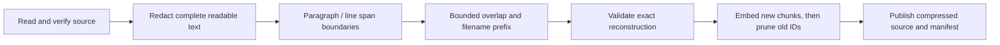

File ingestion and conversation learning split a complete redacted source into contiguous character spans. They preserve indentation, line endings, short messages, import preambles and short trailing text. They run no semantic model before embedding. [ADR 0081](adr/0081-verifiable-redacted-source-snapshots.md) records the storage and chunk contract; [ADR 0082](adr/0082-retain-readable-conversation-evidence.md) records the conversation content contract.

| Setting | Default | Effect |
| --- | --- | --- |
| `chunker.size_code` / `IMPRINT_CHUNK_SIZE_CODE` | 4000 characters | Target for recognized code extensions |
| `chunker.size_prose` / `IMPRINT_CHUNK_SIZE_PROSE` | 6000 characters | Target for other text and conversations |
| `chunker.hard_max` / `IMPRINT_CHUNK_HARD_MAX` | 8000 characters | Cap including the derived filename prefix |
| `chunker.overlap` / `IMPRINT_CHUNK_OVERLAP` | 400 characters | Overlap, bounded to one third of the effective target |

The splitter prefers paragraph and then line boundaries in the latter half of a chunk, falling back to a character cut. A long function may cross chunks. Chonkie's AST and semantic helpers remain for legacy direct callers; `chunk_file` and `chunk_conversation` use the span path. `chunker.semantic_threshold` does not affect those paths.

`source_start` and `source_end` are half-open Unicode character offsets into the redacted source, not offsets into the original private file. `source_prefix` is derived retrieval context, excluded when reconstructing. Overlap is verified for agreement. A manifest records every index, span, content hash and ID, with a source version and expected chunk count. Empty text has a valid zero-chunk snapshot. Extracted documents have one joined text snapshot and ranges for their extracted parts; it does not reconstruct a PDF, image or original binary.

Conversations preserve ordered readable messages, available analysis and rationale, tool calls and outputs, with role/kind/call metadata. Client-injected content is labelled `context`; it does not become a human question. Opaque reasoning and binary attachments are counted as unavailable, and so are runs of NUL bytes a crash left unwritten in a transcript ([ADR 0088](adr/0088-bytes-a-crash-never-wrote-are-counted-omissions.md)). This is an exact reconstruction of the stored readable representation, not of raw transcript JSON. See [source memory](source-memory.md).

`learn` uses learner version 3, the source profile (format, chunk sizes, overlap and Privacy Filter setting), the transcript modification time and the current manifest's ID set to decide whether to skip. Changes trigger learning again, reusing unchanged embeddings and tags. Missing or mismatched snapshot versions and missing/extra chunks trigger repair. A completion watermark is published after every batch and the source snapshot succeed. File refresh applies the profile and manifest checks to modern sources too. Legacy file chunks have no proof of coverage; use `refresh --force` once to create snapshots.
