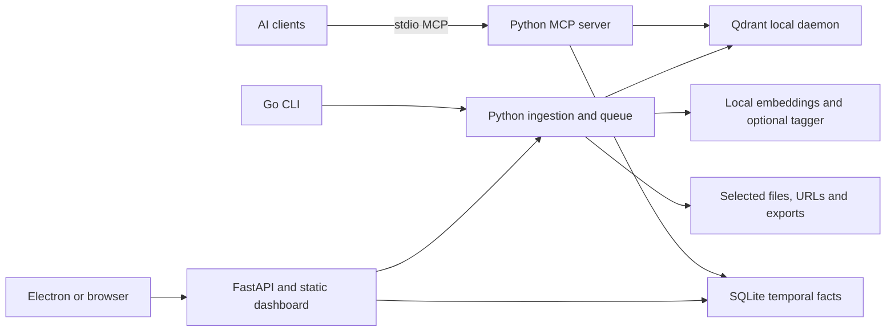

## Scope and evidence

Reviewed on 2026-10-23 against baseline commit `790f907` and the working changes described below. The repository has 428 tracked files, about 24,500 lines across its top-level Python and Go command modules, three Node projects, checked-in cross-platform CLI binaries and a checked-in dashboard export. This is an architectural and implementation review with local verification, not an exhaustive formal audit of every branch or dependency.

GitHub's latest stable `v0.8.0` has archives and native installers. Recent recorded release runs succeeded; the older failed stable run's logs have expired (HTTP 410). Consequently the specific historical installer reports cannot be attributed to a CI log. Findings below come from inspected source and reproduced behavior.

## Target and product position

Imprint provides persistent, searchable context to AI assistants across repositories and sessions. Its main audience is developers who use multiple coding clients and want local ownership of code, decisions, debugging knowledge and conversation history. It also serves technical users searching documents, URLs and exported desktop conversations.

The main value is less repeated exploration and more continuity across tools. MCP makes that value portable; embeddings, metadata filtering and temporal facts make it richer than a folder of notes. A useful product outcome is: install once, connect supported clients, index selected sources, retrieve relevant evidence, store durable findings, and inspect or delete them in a dashboard.

The README's local/zero-cost language needs qualification. Embeddings and storage run locally by default, but installation downloads Python/wheels, Qdrant and models. URL ingestion contacts remote sites, sync contacts a relay/peer, and optional LLM providers can transmit content and incur charges. Token/cost improvements in `BENCHMARK.md` are workload-specific results, not a general guarantee of answer quality or savings.

## Architecture and ownership

| Area | Implementation | Role and concerns |
| --- | --- | --- |
| Launcher and lifecycle | `main.go`, `cmd/`, `internal/platform/`, `internal/runner/` | Setup, profiles, subprocesses, updates, client config, platform paths. Large `setup.go` and duplicated orchestration make error propagation hard to reason about. |
| Retrieval | `imprint/server.py`, `vectorstore.py`, `embeddings.py`, `cli_viz.py` | Fourteen MCP tools; Qdrant vectors, ONNX embeddings, filtered retrieval and result hydration. Shared state and cold model loading deserve concurrency and latency tests. |
| Ingestion | `cli_index.py`, `cli_refresh.py`, `ingest_core.py`, `chunker.py`, `tagger.py`, `extractors/` | Code/document/URL parsing, chunking, tagging and refresh. Native wheels, optional extractors and model/provider combinations increase the support matrix. |
| Durable state | Qdrant plus `imprint_graph.py`, `queue.py`, `chat_store.py`, JSON files | Vectors, temporal facts, jobs, chat and configuration. There is no single transaction or backup boundary across all stores. |
| Dashboard | `imprint/api.py`, `imprint/ui/` | FastAPI serves a Next.js static export; Node is a build dependency, not a runtime requirement. API includes filesystem and command operations. |
| Desktop shell | `ui-electron/` | Tray/window around the local dashboard. It is not the Python backend and does not by itself make a release offline-capable. |
| Client adapters | `cmd/setup_*.go`, `internal/hooks/`, `internal/instructions/` | Registration, managed instructions and client-specific hooks. Capabilities and transcript formats differ by host/version. |
| Sync | `cmd/sync.go`, `imprint/sync_ws.py`, relay commands and Docker files | Peer exchange through a relay, PIN and trust records. Two protocol implementations require shared fixtures and compatibility tests. |
| Distribution | `Makefile`, `scripts/`, `installers/`, workflows | Go binaries, bundled uv, archives, Inno Setup and macOS packages. Native runtime validation is essential. |
| Website and benchmarks | `site/`, `benchmark/`, `BENCHMARK.md` | Public docs, downloads and savings measurements. Documentation is live product content, including the new engineering pages. |

Good existing choices include a narrow portable MCP interface, an isolated managed Python runtime, a server-mode vector store allowing multiple clients, workspace separation, managed instruction blocks, an ingestion queue and a visible dashboard. These are a credible base for a useful developer product.

## Confirmed defects addressed in this change

| Finding | Consequence | Change |
| --- | --- | --- |
| Swift helper used `NSApp` without constructing the application | Helper could fail before showing setup | Initialize `NSApplication.shared` before assigning its delegate. |
| macOS helper path contained `Contents/Contents` | Native setup helper never found | Resolve `MacOS/` from the existing Contents directory. |
| Terminal fallback interpolated shell quotes into an AppleScript string | Fallback setup could fail to parse | Pass arguments to AppleScript and use its `quoted form`. |
| Windows wizard watched a sentinel written inside backend setup | Registration still running when wizard reported success | Separate final result file, guarded page entry and timeout; explicit silent-install setup. |
| Process probes used `os.kill(pid, 0)` on Windows | A status/progress probe can terminate a live process | Shared non-destructive Win32 liveness helper plus subprocess regression test. |
| Hook commands used unquoted paths, POSIX env assignments and shell-specific output | Default Windows install paths and paths with spaces broke automation | Absolute Python hook entry point, platform quoting and structured JSON output. |
| Electron preload omitted from package | Custom window controls unavailable | Include preload and navigation module explicitly. |
| Hostname prefix checks and disabled renderer sandbox | Lookalike hosts accepted and renderer isolation weakened | Exact URL parsing/origin checks, protocol allowlist and sandbox enabled. |
| Dashboard API allowed every browser origin | Unrelated websites could interact with local filesystem/command routes | Reject remote Origin headers and restrict CORS to loopback dashboards. This is not remote authentication. |
| One x64 Electron AppImage inserted in both Linux archives | ARM desktop launch used the wrong executable | Build, stage and validate separate architectures. |
| `make package` removed installer staging directories | Documented native installer targets could not consume its output | Shared staging script retains platform trees and preserves unrelated outputs. |
| Releases published before native installers finished | Partially populated releases and checksum coverage gaps | Shared build workflow publishes only after all required native checks, including installers in checksums. |
| Releases reused committed dashboard export | UI source changes could be absent from installers | Rebuild dashboard and validate required runtime files for every release. |
| Default ONNX graph loaded through Hub cache symlinks | Recent ONNX Runtime rejected external weight paths; semantic search failed | Materialize graph/weights together with `local_dir`; reuse the same CPU graph. |
| Requirements had no upper bounds or resolved baseline | Fresh installs could change arbitrarily; client/server warning reproduced | Universal base dependency lock and a Qdrant client range matching pinned server. |
| Repeated `setup all` provisioning and hard-coded Codex home | Extra setup work and wrong profile edits | Cache backend preparation within the invocation; honor `CODEX_HOME`. |

## Follow-up implementation and remaining risks

The follow-up implements the UI, source indexing, retrieval, MCP and audit corrections in the [remediation tracker](audit-remediation.md). Electron is now 45.0.0 with an explicit macOS 13 desktop floor; Python profiles are hash-locked; uv/Qdrant and release archives verify checksums. Client edits preserve owned/custom settings with backups. Indexing has byte provenance and upsert-before-prune ordering, hybrid retrieval shares one backend, MCP writes are durable, and dashboard lint/browser gates now pass locally.

The main unresolved risks are native Windows/macOS installer execution, signing/notarization, nine high dashboard development-tool advisories, GPU/LLM repair reproducibility, signed model/runtime provenance, complete backup/restore, PID identity/cancellation, JSONC/concurrent configuration edits and live host-version compatibility. Loopback Host/Origin checks are not remote authentication or a filesystem sandbox. Source replacement is recoverable but not a multi-point transaction. Similarity and heuristic fusion have not been evaluated on a held-out relevance corpus.

See [indexing and retrieval](indexing-retrieval.md) and [UI/UX review](ui-ux-review.md) for concrete behavior and next acceptance criteria, the [quality roadmap](quality-roadmap.md) for priorities, and [platform validation](platform-validation.md) for exactly what was executed. Native and interactive checks remain pending even where source defects are corrected.
