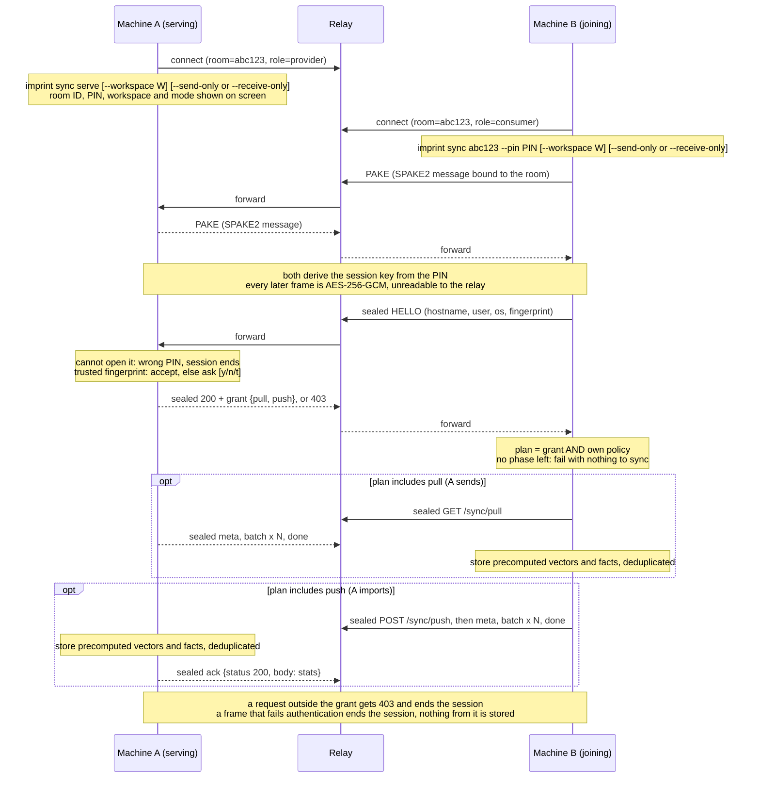

## Device provenance

Memory and graph origins survive sync; imported paths are references until mapped on the receiver. Device identity does not partition shared knowledge or change vectors. Local identity/root mappings are not transferred. See [devices and portable project paths](devices.md).

## Peer Sync

Live sync merges one workspace between two machines through a relay that only pairs them by room ID and forwards frames. Sessions are end-to-end encrypted with the PIN, so the relay — including the default public one — never sees the PIN, the devices or the memories.

There is one implementation, [`imprint/sync_ws.py`](../imprint/sync_ws.py) (async-generator sessions that yield events). The CLI renders them in a terminal ([`imprint/cli_sync.py`](../imprint/cli_sync.py); `imprint sync` is a thin Go wrapper that runs it), and the dashboard streams the same events over SSE. The relay itself is Go ([`cmd/relay.go`](../cmd/relay.go)). See [ADR 0018](adr/0018-single-sync-implementation-and-end-to-end-encryption.md).



The public relay at `wss://imprint.alexandruleca.com` is the default — pass `--relay` to use your own. Room IDs expire after 1 hour.

**What transfers** (from the selected workspace only):

- Qdrant points — content, metadata **and the stored vector**, streamed in batches. Each record carries the sender's `embedding_identity`; the importer rejects a missing or mismatched identity before any upsert, so both machines need the same embedding profile (see [embedding profile compatibility](#embedding-profile-compatibility)). Imports dedup by the record's logical ID.
- Knowledge graph facts (SQLite `facts` table) — streamed in batches, deduped by `(subject, predicate, object, valid_from)`.
- **Not** transferred: other workspaces, the WAL, config, the trust list, workspace roots and purge exclusions.

**Payload framing:** inside the sealed channel, data is newline-delimited JSON — `{"kind":"meta",...}`, `{"kind":"batch","dataset":"memories"|"facts","seq":N,"records":[...]}`, `{"kind":"done"}`, or `{"kind":"error","message":"..."}` when the sender cannot export. Batches hold 500 records; a frame may be up to 64 MiB.

### End-to-end encryption

The serving machine generates a one-time 8-character PIN per session. Both machines turn it into a shared key with **SPAKE2** (a password-authenticated key exchange; [`spake2`](https://github.com/warner/python-spake2) 0.9, the release magic-wormhole uses) over Ed25519, with the protocol label and room ID bound into the key:

- The PIN never crosses the relay. The two exchange messages reveal nothing a relay can test PIN guesses against offline.
- A relay that tries to take part gets one guess per session: a wrong PIN ends the session on the serving side.
- HKDF-SHA256 derives a key per direction; every later frame is **AES-256-GCM** with the frame count as nonce, so a frame that is altered, dropped, replayed or reordered fails to open and the session stops. Nothing from a failed stream is stored.
- A wrong PIN shows as *Wrong PIN from peer* on the serving side and *Handshake rejected: wrong PIN* on the joining side.

**What the relay can see:** the room ID, the two key-exchange messages, the number, sizes and timing of ciphertext frames, and the machines' IP addresses. Not the PIN, hostnames, users, fingerprints, memories, vectors or facts. A relay can always refuse to forward (deny service). Run [your own relay](./docker.md) if metadata such as transfer size and timing matters to you.

**Compatibility:** this is sync protocol 2. Versions before it sent the PIN and data in clear and are rejected on both sides — there is no unencrypted fallback a relay could force. An older joining machine gets *update Imprint on both machines: live sync is now end-to-end encrypted* (status 426); a newer joining machine tells you when the serving one is older. Update both machines.

### Direction: two-way or one-way

Each machine states what **it** is willing to do. The default is two-way; `--send-only` and `--receive-only` are mutually exclusive and work on both `imprint sync serve` and `imprint sync <target>`. The dashboard and API call the same policy `direction`: `both`, `send` or `receive`.

| Flag | Dashboard | This machine | Served to a peer | When joining |
|---|---|---|---|---|
| _(none)_ | Two-way | sends and imports | peers can pull and push | pull, then push |
| `--send-only` | Send only | sends, imports nothing | peers can pull; pushes are refused | push only |
| `--receive-only` | Receive only | imports, sends nothing | peers can push; pulls are refused | pull only |

- **Handshake.** The serving side's sealed `200` reply body is the grant: `{"pull": bool, "push": bool}`, what the joining side may request (`pull`: the serving side sends; `push`: it imports).
- **Plan.** The joining side runs `pull = grant.pull AND it may receive` and `push = grant.push AND it may send`, prints the plan (`Plan: pull only — push skipped (the provider is send-only)`) and skips the other phase. The dashboard shows the same line from a `{"type":"plan",...}` event. If no phase remains, it fails before transferring anything: `nothing to sync: pull skipped (this machine is send-only), push skipped (the provider is send-only)`.
- **Enforcement.** The serving side applies its own policy whatever the joining side requests: a request outside the grant gets `{"status":403,"body":"provider is serving send-only: pushes are refused"}` (or the receive-only equivalent) and ends the session without importing or sending anything.
- Unknown flags are errors, so a misspelled `--send-only` cannot turn into a two-way sync. `--fresh` with `--send-only` is rejected because nothing is downloaded.

### Workspace selection

`--workspace NAME` syncs that workspace without changing the active one. Without it, the session uses the active workspace, captured once at start so a later `imprint workspace switch` or dashboard switch cannot redirect it. The workspace is passed explicitly through export and import, and both front-ends show which one is being synced.

- **Serving** requires an existing workspace.
- **Joining** may name a new workspace as the destination for the peer's memories. It is registered (not switched to) just before the first pulled data is stored. A send-only join, or a plan that only pushes, needs an existing workspace to send from.

### Resuming an interrupted download

The CLI writes a pulled stream to `data/sync-buffer.jsonl` (via a `.tmp` file renamed only once the stream is complete) and deletes it once stored. If storing fails, the download is kept, and the next `imprint sync … --workspace W` stores it locally without the peer — whose room has closed by then — and without a PIN. The buffer records its destination workspace; a run for a different workspace is refused until you finish it (`--workspace <that one>`) or discard it (`--fresh`). Buffers from versions before `--workspace` carry no workspace and resume into the active one. A `--send-only` join leaves the buffer untouched. The dashboard stores pulls from a temporary file instead.

### Share part of your memory

Curate a workspace with [`migrate --copy`](workspaces.md#copy-move-and-share-a-workspace), which leaves your own workspace intact, then serve only that workspace, one way:

```bash
# Your machine: build a team workspace from selected projects/topics
imprint migrate --from default --to team --project payments-api --copy
imprint migrate --from default --to team --topic auth --copy
imprint sync serve --workspace team --send-only
#   Workspace:   team
#   Mode:        send-only — peers can pull, pushes are refused

# Colleague's machine: receive it into a workspace of their own
imprint sync abc123 --pin Ab3xY9Kq --workspace from-alice --receive-only
#   Plan: pull only — push skipped (this machine is receive-only)
```

The colleague can read `team` but cannot write to it, and nothing outside `team` leaves your machine. Re-run the copies and the sync to refresh: memories and facts are deduplicated on both steps. Neither step deletes: a memory you remove or rewrite on your side stays in `team` and on the colleague's machine until it is removed there too. In the dashboard, pick the workspace and **Send only** on **Sync → Live Sync → Serve**; the colleague uses **Receive** with a workspace name of their own and **Receive only**.

### Choosing a relay

| Form | Example | Meaning |
|------|---------|---------|
| _(omit `--relay`)_ | `imprint sync serve` | Use default `wss://imprint.alexandruleca.com` |
| Bare host | `--relay sync.example.com` | Auto-pick scheme (`wss` unless localhost/127.*) |
| Explicit WSS | `--relay wss://sync.example.com` | Force `wss://` |
| Plain WS | `--relay ws://localhost:8430` | Force `ws://` (useful for local testing) |

The joining side accepts what the serving side prints: a bare room ID on the default relay, or `<host>/<id>` / `wss://<host>/<id>` on any other. The dashboard's **Serve** tab takes the same optional relay host, and **Receive** accepts any of these forms. With end-to-end encryption, a self-hosted relay protects transfer metadata rather than content.

### Device approval

The PIN authenticates the session. On top of it, the serving machine decides which devices may sync:

- **Device fingerprint** — stable 8-char hex ID persisted at `data/device_id.txt`, one per machine. It arrives inside the sealed HELLO. The serving machine asks you to accept an unknown fingerprint; fingerprints in `data/trusted_devices.json` are accepted without asking. A fingerprint is an identifier, not a secret — trust skips the question, never the PIN.

Prompt options on the serving side:
- `y` / `yes` — accept this session only
- `t` / `trust` — accept and remember the fingerprint
- anything else — reject

The dashboard surfaces the same gate: after the key exchange, the server emits an `approval_required` event with the peer's hostname / user / os / fingerprint, and waits. The UI renders **Accept once** / **Trust & accept** / **Reject** buttons that POST `/api/sync/approve` with `{session_id, decision}`; any other decision rejects. Previously-trusted fingerprints auto-accept (emitting `auto_accepted` instead). The trust list is shared between CLI and dashboard sessions.

```bash
# Use the default public relay
imprint sync serve
# → prints: imprint sync abc123 --pin Ab3xY9Kq
# → also prints: This device: hostname (id: a3f2c1d4)

imprint sync abc123 --pin Ab3xY9Kq          # Machine B, default relay

# Or self-host the relay
imprint relay --port 8430

imprint sync serve --relay sync.yourdomain.com
# → prints: imprint sync wss://sync.yourdomain.com/abc123 --pin Ab3xY9Kq

imprint sync wss://sync.yourdomain.com/abc123 --pin Ab3xY9Kq
# → Machine A sees hostname/user/os/fingerprint + prompts [y/n/t]
# → on accept: two-way merge of the active workspace, done
```

Prebuilt relay images are on GHCR — see the [Docker deployment guide](./docker.md) for pinned tags, `docker compose`, and TLS termination.

## Dashboard

```bash
imprint ui
```

Opens the Imprint dashboard (FastAPI + Next.js) with memory browsing, search, stats, and chat.

## Embedding profile compatibility

Vector transfers require the same encoding identity (ADR 0010). New stream records carry `embedding_identity`; unknown or mismatched precomputed vectors fail before upsert. Snapshot manifests also carry identity and are checked before recovery. Legacy streams/bundles require reindexing/export with matching settings. Workspace migration retains vectors and therefore requires compatible collections; it is not a model conversion. Raw text/source reingestion is the rebuild path. Identity is a compatibility check, not proof of peer trust.

Precomputed imports preserve a supplied logical ID only when it matches the content/project/source identity, with or without the supplied chunk position. This keeps a manually stored note distinct from an indexed chunk at position zero and prevents sync from duplicating a note under a recalculated chunk ID. Conflicting IDs fail before upsert.
