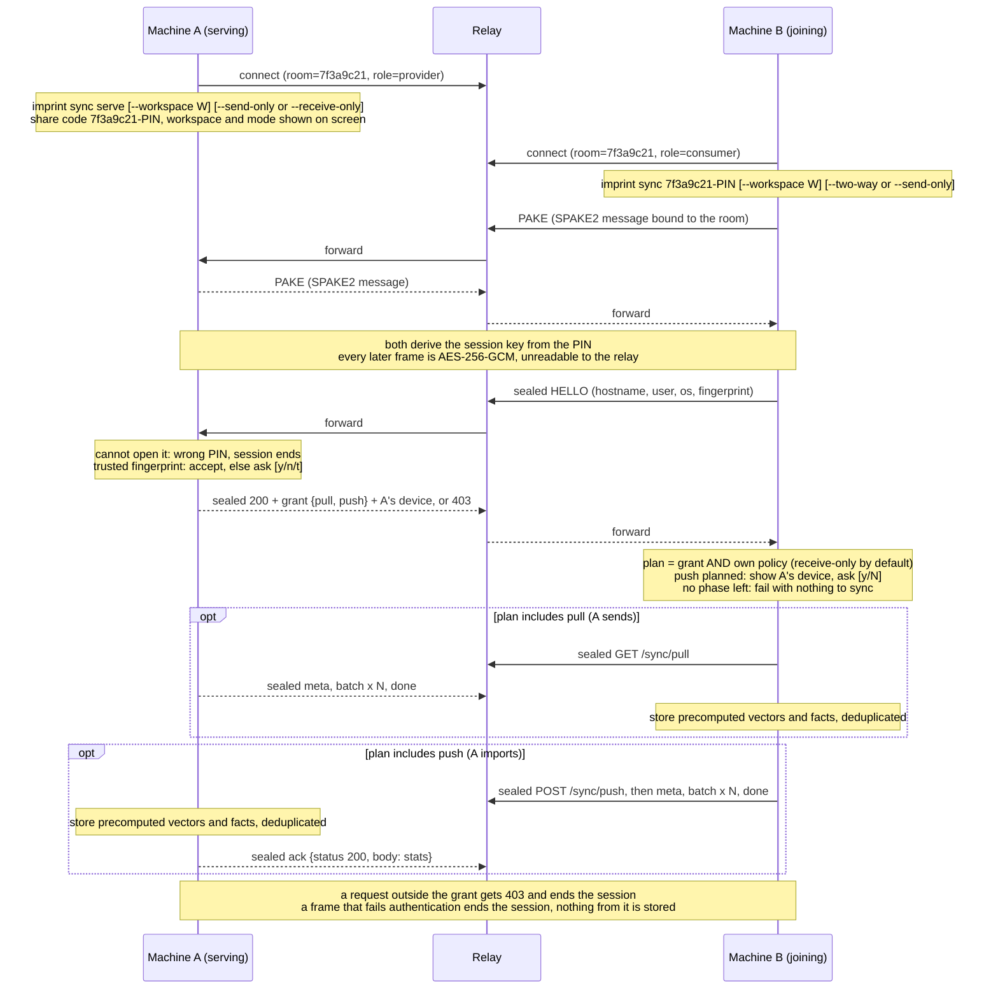

## Device provenance

Memory and graph origins survive sync; imported paths are references until mapped on the receiver. Device identity does not partition shared knowledge or change vectors. Local identity/root mappings are not transferred. See [devices and portable project paths](devices.md).

## Peer Sync

Live sync copies one workspace between two machines through a relay that only pairs them by room and forwards frames. The serving machine prints a one-time share code; the other machine passes it to `imprint sync`. Sessions are end-to-end encrypted with the code's secret part, so the relay — including the default public one — never sees it, the devices or the memories. Joining only receives unless you add `--two-way` or `--send-only`, and then you see which machine gets your workspace and confirm before anything is sent.

There is one implementation, [`imprint/sync_ws.py`](../imprint/sync_ws.py) (async-generator sessions that yield events). The CLI renders them in a terminal ([`imprint/cli_sync.py`](../imprint/cli_sync.py); `imprint sync` is a thin Go wrapper that runs it), and the dashboard streams the same events over SSE. The relay itself is Go ([`cmd/relay.go`](../cmd/relay.go)). See [ADR 0018](adr/0018-single-sync-implementation-and-end-to-end-encryption.md).



The public relay at `wss://imprint.alexandruleca.com` is the default — pass `--relay` to use your own. The relay pairs one provider and one consumer per room and refuses a second connection for a taken role, caps messages at 80 MiB, and closes rooms still waiting for their second peer after 1 hour (a paired transfer runs as long as it needs). Frames a peer sends before the other one joins are held, up to 1 MiB, and delivered first when it joins, so paired devices that reconnect at the same moment can arrive in either order. Relays before v0.20.1 dropped those frames: when the consumer joined first, its key exchange was lost and automatic sync failed with "The other machine did not answer the key exchange" until one side's timing changed. Only WebSocket requests reach rooms, so protocol errors go to sync clients alone; a browser on any address of the relay gets a static page that explains it ([`cmd/relay.html`](../cmd/relay.html), 404 off the root). The page has no scripts or third-party requests unless the operator starts the relay with `--ga4-id G-…`, which adds Google Analytics page views reported as `/` or `/not-found`, never the address itself, since a path may carry a share code. `GET /health` returns `{"status","version","rooms","sessions","since"}`: open rooms, rooms both peers joined since the relay started (paired devices reconnect about once a minute, and each reconnect counts), and that start time. Counters live in memory and reset on restart. Any origin may read it, so the website can show the public relay's status.

**What transfers** (from the selected workspace only):

- Qdrant points — content, metadata **and the stored vector**, streamed in batches. Each record carries the sender's `embedding_identity`; the importer rejects a missing or mismatched identity before any upsert, so both machines need the same embedding profile (see [embedding profile compatibility](#embedding-profile-compatibility)). Imports dedup by the record's logical ID.
- Knowledge graph facts (SQLite `facts` table) — streamed in batches, deduped by `(subject, predicate, object, valid_from)`.
- **Not** transferred: other workspaces, the WAL, config, the trust list, workspace roots, purge exclusions and project placement rules.
- Moved memories travel with their origin project. The receiver places them by its own rules, so each device keeps its own project layout and copies dedupe instead of undoing a move ([ADR 0036](adr/0036-move-memories-between-projects.md)).
- Imported records are evidence, not authority: `imprint refresh-urls` (and the MCP refresh) re-fetch only URLs this device recorded, never URLs that arrived through sync.

### Automatic sync between paired devices

A one-time sync stays one-time unless **both** devices enable automatic pairing.
In the dashboard, check **Enable automatic sync with this device after pairing**
on Serve and Receive before starting. Choose the workspace and direction first;
joining still defaults to receive-only. The existing approval and send
confirmation apply. A declined push is never remembered as permission to send.
The success note confirms when pairing has completed.

```bash
# Device A: offer pairing for this workspace
imprint sync serve --workspace team --remember
# Device B: receive and send, after confirmation; workspace names may differ
imprint sync <code> --workspace team-local --two-way --remember
# Keep this running on each device, or leave each dashboard/backend running
imprint sync watch
```

The backend reconnects through the same relay using a new, private pair capability,
not the old share PIN or a device fingerprint. It verifies the paired workspace
mapping and only runs the approved directions. Changed workspace data merges
about once a minute when both workers can connect; unchanged digests skip the
vector transfer. No model or embedding call is required. Turning off the app,
network outages or an unavailable relay delay sync. `watch` is a foreground
service command; pairing does not silently install a system startup service.

**Sync → Paired devices** shows the relay, local/remote workspace, direction,
last completed sync and connection errors. **Pause automatic sync** on either
side stops workspace transfers; **Enable automatic sync** resumes without a new
code. CLI equivalents:

```bash
imprint sync peers
imprint sync disable <pair-id>
imprint sync enable <pair-id>
imprint sync forget <pair-id>  # asks for confirmation; no implicit --yes
```

**Forget device…** requires confirmation and affects **all paired workspaces
with that device**. It revokes automatic transfer locally and removes its old
fingerprint trust immediately. When both workers reconnect, an encrypted
notification causes the other device to forget this one too. While it is offline,
the interface says **remote removal pending**. Keep Imprint running on both to
finish; the relay does not store an offline revocation mailbox. A lost final
acknowledgement may leave a pending notification rather than a false success.
Existing memories remain on both machines; forgetting cannot retract knowledge
already shared. Pair again with a fresh code to restore authorization.

Pause/forget control frames run before opening either index, so revocation also
works after a workspace is removed or embedding settings become incompatible.
Automatic data transfer never recreates a deleted workspace implicitly.

Pair credentials live only in `data/sync-pairs.sqlite3` (0600 on Unix; the data
directory ACL applies on Windows) and are omitted from peer API responses,
exports and snapshots. Back up this data directory as sensitive local state.
Do not clone its device identity or pairing database onto another machine.
The relay can correlate a stable opaque pair room but cannot read credentials,
device names, workspace names or memories. Protocol-2 peers without this optional
pairing extension can still perform one-time sync.

Imprint checks the pairing database's integrity whenever it opens it and
rebuilds its indexes when the check fails. Earlier Windows releases opened the
file in text mode, and the C runtime then removed its last byte whenever that
byte was 0x1A, which happened after about 26 automatic syncs. Sync stopped and
**Paired devices** reported "database disk image is malformed". The pairings
themselves were intact, so the first open after updating repairs the file and
automatic sync resumes. A database the rebuild cannot repair is reported with
its path. Pair the device again after moving that file aside.

This remains a deduplicating **merge**: local deletions are not remote deletion
commands. The digest check scans local exported records, and imports can cause
one extra deduplicating pass. See [ADR 0020](adr/0020-explicit-pairing-and-automatic-workspace-sync.md).

### The share code

`imprint sync serve` prints one argument for the other machine: `7f3a9c21-Ab3xY9Kq` on the default relay, or `wss://sync.example.com/7f3a9c21-Ab3xY9Kq` on any other. Before the dash is the room ID, which tells the relay which two connections to pair; after it is the 8-character PIN, generated per session, which only the two machines use. The joining side also accepts `<host>/<code>` and `ws://` addresses. A code works for one session; serve again for a new one.

**Payload framing:** inside the sealed channel, data is newline-delimited JSON — `{"kind":"meta",...}`, `{"kind":"batch","dataset":"memories"|"facts","seq":N,"records":[...]}`, `{"kind":"done"}`, or `{"kind":"error","message":"..."}` when the sender cannot export. Batches hold 500 records; a frame may be up to 64 MiB.

### End-to-end encryption

Both machines turn the PIN in the share code into a shared key with **SPAKE2** (a password-authenticated key exchange; [`spake2`](https://github.com/warner/python-spake2) 0.9, the release magic-wormhole uses) over Ed25519, with the protocol label and room ID bound into the key:

- The PIN never crosses the relay. The two exchange messages reveal nothing a relay can test PIN guesses against offline.
- A relay that tries to take part gets one guess per session: a wrong PIN ends the session on the serving side.
- HKDF-SHA256 derives a key per direction; every later frame is **AES-256-GCM** with the frame count as nonce, so a frame that is altered, dropped, replayed or reordered fails to open and the session stops. Nothing from a failed stream is stored.
- A wrong PIN shows as *Wrong PIN from peer* on the serving side and *Handshake rejected: wrong PIN* on the joining side.

**What the relay can see:** the room ID, the two key-exchange messages, the number, sizes and timing of ciphertext frames, and the machines' IP addresses. Not the PIN, hostnames, users, fingerprints, memories, vectors or facts. A relay can always refuse to forward (deny service), and before the session is sealed it can send a plaintext notice that ends the handshake; notices are shown as fixed text, never as what the frame says. Text from the peer (device names, error messages) is stripped of control characters before it is shown. Run [your own relay](./docker.md) if metadata such as transfer size and timing matters to you.

**Compatibility:** this is sync protocol 2. Versions before it sent the PIN and data in clear and are rejected on both sides — there is no unencrypted fallback a relay could force. Those versions took the PIN as a separate `--pin`, so given a share code they stop with *--pin is required* before connecting: an older joining machine cannot leak the PIN to the relay. A newer joining machine tells you when the serving one is older; an older joining machine that does connect gets *update Imprint on both machines: live sync is now end-to-end encrypted* (status 426). Update both machines before syncing.

### Direction: who sends

Each machine states what **it** is willing to do. The dashboard and API call this policy `direction`: `both`, `send` or `receive`.

| Serving (`imprint sync serve`) | Dashboard | Served to the peer |
|---|---|---|
| _(none)_ | Two-way | the peer may pull and push |
| `--send-only` | Send only | the peer may pull; pushes are refused |
| `--receive-only` | Receive only | the peer may push; pulls are refused |

| Joining (`imprint sync <code>`) | Dashboard | This machine |
|---|---|---|
| _(none)_ | Receive only | pulls; sends nothing |
| `--two-way` | Two-way | pulls, then pushes after you confirm |
| `--send-only` | Send only | pushes after you confirm; imports nothing |

Joining defaults to receive-only because the code is all a machine needs to join: whoever handed it to you should not get your workspace unless you choose to send it.

- **Handshake.** The serving side's sealed `200` reply body is the grant plus its device: `{"pull": bool, "push": bool, "device": {hostname, user, os, fingerprint}}`. `pull` means the serving side sends; `push` means it imports.
- **Plan.** The joining side runs `pull = grant.pull AND it may receive` and `push = grant.push AND it may send`, prints the plan (`Plan: pull only — push skipped (this machine is receive-only)`) and skips the other phase. The dashboard shows the same line from a `{"type":"plan",...}` event. If no phase remains, it fails before transferring anything: `nothing to sync: pull skipped (this machine is send-only), push skipped (the provider is send-only)`.
- **Confirmation.** When the plan includes a push, the joining side first shows the serving machine and asks: `Send your workspace 'team' to studio (alice, Linux, id a3f2c1d4)? [y/N]`. Anything but yes skips the push — the pull still runs, or the session ends with `nothing to sync: … push skipped (you chose not to send)` if there is none. The dashboard asks with **Send** / **Don't send** buttons (a `confirm_push` event answered through `/api/sync/approve`). Trusting a device skips the serving side's approval, never this question.
- **Enforcement.** The serving side applies its own policy whatever the joining side requests: a request outside the grant gets `{"status":403,"body":"provider is serving send-only: pushes are refused"}` (or the receive-only equivalent) and ends the session without importing or sending anything.
- Unknown flags are errors, so a misspelled flag cannot widen a sync. `--fresh` with `--send-only` is rejected because nothing is downloaded.

### Workspace selection

`--workspace NAME` syncs that workspace without changing the active one. Without it, the session uses the active workspace, captured once at start so a later `imprint workspace switch` or dashboard switch cannot redirect it. The workspace is passed explicitly through export and import, and both front-ends show which one is being synced.

- **Serving** requires an existing workspace.
- **Joining** may name a new workspace as the destination for the peer's memories. It is registered (not switched to) when the pull starts. A join that only pushes needs an existing workspace to send from.

### Resuming an interrupted download

Every run downloads into a file of its own in the data directory (mode 0600 on Linux and macOS; on Windows the data directory's access rules apply) and stores from it, so concurrent runs never share a download. If storing fails, the CLI keeps the download as `data/sync-buffer.jsonl`, and re-running the same `imprint sync <code> --workspace W` stores it locally without the peer, whose room has closed by then. Every line of the stream is validated (one header with vectors, batches, then `done`) and written re-serialised, so a malformed or hostile stream is rejected instead of kept. The buffer records its destination workspace; a run for a different workspace is refused until you finish it (`--workspace <that one>`) or discard it (`--fresh`). Buffers from versions before `--workspace` carry no workspace and resume into the active one. A `--send-only` join leaves the buffer untouched. The dashboard stores pulls from a temporary file instead.

### Share part of your memory

Curate a workspace with [`migrate --copy`](workspaces.md#copy-move-and-share-a-workspace), which leaves your own workspace intact, then serve only that workspace, one way:

```bash
# Your machine: build a team workspace from selected projects/topics
imprint migrate --from default --to team --project payments-api --copy
imprint migrate --from default --to team --topic auth --copy
imprint sync serve --workspace team --send-only
#   Workspace:   team
#   Mode:        send-only — peers can pull, pushes are refused

#   imprint sync 7f3a9c21-Ab3xY9Kq

# Colleague's machine: receive it into a workspace of their own
imprint sync 7f3a9c21-Ab3xY9Kq --workspace from-alice
#   Plan: pull only — push skipped (this machine is receive-only)
```

The colleague can read `team` but cannot write to it, and nothing outside `team` leaves your machine. Their join receives only, so nothing of theirs comes back either. Re-run the copies and the sync to refresh: memories and facts are deduplicated on both steps. Neither step deletes: a memory you remove or rewrite on your side stays in `team` and on the colleague's machine until it is removed there too. In the dashboard, pick the workspace and **Send only** on **Sync → Live Sync → Serve**; the colleague pastes the code on **Receive** with a workspace name of their own.

### Choosing a relay

| Form | Example | Meaning |
|------|---------|---------|
| _(omit `--relay`)_ | `imprint sync serve` | Use default `wss://imprint.alexandruleca.com` |
| Bare host | `--relay sync.example.com` | Auto-pick scheme (`wss` unless localhost/127.*) |
| Explicit WSS | `--relay wss://sync.example.com` | Force `wss://` |
| Plain WS | `--relay ws://localhost:8430` | Force `ws://` (useful for local testing) |

The serving side prints the share code with the relay address in front when it is not the default (`wss://<host>/<code>`); the joining side also accepts `<host>/<code>`. The dashboard's **Serve** tab takes the same optional relay host, and **Receive** accepts any of these forms. With end-to-end encryption, a self-hosted relay protects transfer metadata rather than content.

### Device approval

The share code authenticates the session. On top of it, the serving machine decides which devices may sync, and the joining machine sees the serving device before it sends anything ([confirmation](#direction-who-sends)):

- **Device fingerprint** — stable 8-char hex ID persisted at `data/device_id.txt`, one per machine. It arrives inside the sealed HELLO. The serving machine asks you to accept an unknown fingerprint; fingerprints in `data/trusted_devices.json` are accepted without asking. A fingerprint is an identifier, not a secret — trust skips the question, never the code.

Prompt options on the serving side:
- `y` / `yes` — accept this session only
- `t` / `trust` — accept and remember the fingerprint
- anything else — reject

The dashboard surfaces the same gate: after the key exchange, the server emits an `approval_required` event with the peer's hostname / user / os / fingerprint, and waits. The UI renders **Accept once** / **Trust & accept** / **Reject** buttons that POST `/api/sync/approve` with `{session_id, decision}`; any other decision rejects. Previously-trusted fingerprints auto-accept (emitting `auto_accepted` instead). The trust list is shared between CLI and dashboard sessions.

```bash
# Use the default public relay
imprint sync serve
# → prints: imprint sync 7f3a9c21-Ab3xY9Kq
# → also prints: This device: hostname (id: a3f2c1d4)

imprint sync 7f3a9c21-Ab3xY9Kq              # Machine B, default relay: receives only
imprint sync 7f3a9c21-Ab3xY9Kq --two-way    # or receive, then send after confirming

# Or self-host the relay
imprint relay --port 8430

imprint sync serve --relay sync.yourdomain.com
# → prints: imprint sync wss://sync.yourdomain.com/7f3a9c21-Ab3xY9Kq

imprint sync wss://sync.yourdomain.com/7f3a9c21-Ab3xY9Kq --two-way
# → Machine A sees hostname/user/os/fingerprint + prompts [y/n/t]
# → Machine B sees Machine A's device and is asked before sending [y/N]
# → on both yes: two-way merge of the active workspace, done
```

Prebuilt relay images are on GHCR — see the [Docker deployment guide](./docker.md) for pinned tags, `docker compose`, and TLS termination.

## Dashboard

```bash
imprint ui
```

Opens the Imprint dashboard (FastAPI + Next.js) with memory browsing, search, stats, and chat.

## Embedding profile compatibility

Vector transfers require the same encoding identity (ADR 0010). New stream records carry `embedding_identity`; unknown or mismatched precomputed vectors fail before upsert. Snapshot manifests also carry identity and are checked before recovery. Legacy streams/bundles require reindexing/export with matching settings. Workspace migration retains vectors and therefore requires compatible collections; it is not a model conversion. Raw text/source reingestion is the rebuild path. Identity is a compatibility check, not proof of peer trust.

Precomputed imports preserve a supplied logical ID only when it matches the content/project/source identity, with or without the supplied chunk position. This keeps a manually stored note distinct from an indexed chunk at position zero and prevents sync from duplicating a note under a recalculated chunk ID. Conflicting IDs fail before upsert.
