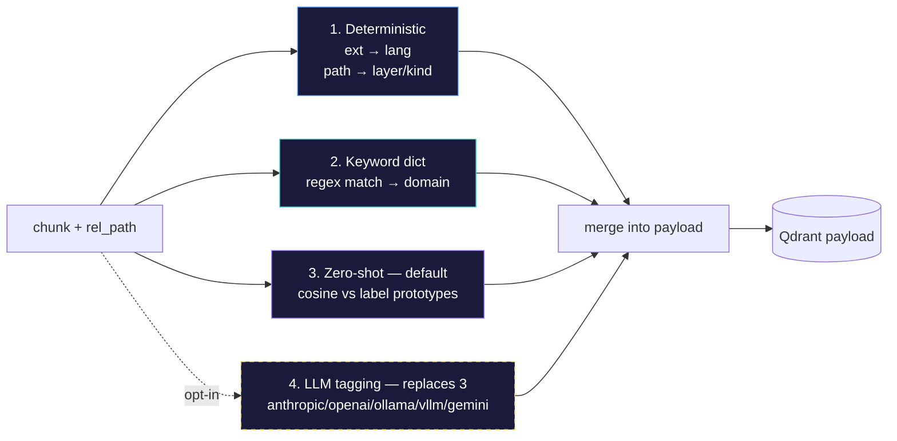

Every chunk gets a structured tag payload stored in Qdrant:

```python
{
    "lang":   "python",                 # from file extension
    "layer":  "api",                    # from path (api/ui/tests/infra/...)
    "kind":   "source",                 # source/test/migration/readme/types/...
    "domain": ["auth", "db"],           # keyword-matched topics
    "topics": ["jwt-validation", ...]   # zero-shot (default) or LLM-derived
}
```



Four tag sources, layered from cheap to rich:

| # | Source | What it produces | Cost | Default |
|---|--------|-----------------|------|---------|
| 1 | **Deterministic** | `lang` (from extension), `layer` (from path), `kind` (from filename) | Free | Always on |
| 2 | **Keyword dict** | `domain[]` — 13 categories via regex: auth, db, api, math, rendering, ui, testing, infra, ml, perf, security, build, payments | Free | Always on |
| 3 | **Zero-shot** | `topics[]` — cosine similarity against pre-embedded label prototypes (threshold > 0.35) | 1 vector compare per chunk per label | **On by default** (opt-out: `IMPRINT_ZERO_SHOT_TAGS=0`) |
| 4 | **LLM tagging** | `type`, `domain[]`, `topics[]` (and refined `lang`/`layer`/`kind`) from one LLM call per chunk | 1 API call per chunk, in the background | Opt-in (`IMPRINT_LLM_TAGS=1`), **replaces** zero-shot once it has run |

When LLM tagging is enabled its classification replaces the keyword domains and zero-shot topics a memory was stored with. See [tagger.py](../imprint/tagger.py) for implementation.

## LLM tagging runs in the background

No command that stores memories runs the LLM itself: learn, ingest, refresh, ingest-url, refresh-urls, desktop learn, the Stop hook's import and extraction, and inline content (MCP `ingest_content`, browser capture) store memories with sources 1–3 and finish once they are embedded and searchable. While `tagger.llm` is on, each memory they store is also marked `tag_pending`. The dashboard's background tagging job classifies the marked memories when no other job runs or waits: every workspace, the active one first, newest memories first, one memory per write. It steps aside between memories for any queued job, and any other process that needs the queue lock stops it; it resumes later from the memories still marked, so a crash or cancel loses at most one classification. The Queue page shows its state and how many memories wait ([queue](queue.md), [ADR 0067](adr/0067-background-llm-tagging-that-yields-to-every-job.md)).

- **Without the dashboard** nothing tags in the background. A storing command prints how many memories wait; `imprint retag --pending` tags them now, newest first. `imprint retag` still classifies every memory not yet LLM-tagged, which includes them.
- **Turning LLM tagging on** marks only memories stored from then on; earlier memories are classified with `imprint retag`. Turning it off stops the background job between memories; the marks stay for when it is turned on again. The dashboard's own setting decides whether the background job runs.
- **A configuration that cannot tag** (no llama.cpp binding or model for `local`, a missing API key) makes the background job fail without touching a memory; it retries after 30 minutes, when a `tagger.*` setting changes, or from **Resume now** on the Queue page.
- **Sync** never carries the mark. The device that stored a memory tags it, and the classification reaches other devices through its `tagged_at` stamp ([ADR 0051](adr/0051-synced-tags-follow-the-latest-retag.md)); a classification received that way clears a local mark.

Every provider, local or remote, receives the classification prompt with its secrets redacted, so tags and types are derived from redacted text ([secret redaction](redaction.md#text-sent-to-models)).

## LLM Tagger Providers

Set `IMPRINT_LLM_TAGS=1` and pick a provider:

| Provider | `IMPRINT_LLM_TAGGER_PROVIDER` | Default model | API key env var | Notes |
|---|---|---|---|---|
| Anthropic | `anthropic` | `claude-haiku-4-5` | `ANTHROPIC_API_KEY` | Uses native Anthropic SDK |
| OpenAI | `openai` | `gpt-4o-mini` | `OPENAI_API_KEY` | OpenAI SDK |
| Gemini | `gemini` | `gemini-2.0-flash` | `GOOGLE_API_KEY` | Via OpenAI-compatible endpoint |
| Ollama | `ollama` | `llama3.2` | — | Local server, no API key needed |
| vLLM | `vllm` | `default` | — | Local server, no API key needed |
| Local (llama-cpp) | `local` (default) | `Qwen3.5-4B Q4_K_M` (auto GGUF download) | — | In-process via `llama-cpp-python`, no server required. Tune via `tagger.local.model_repo`, `tagger.local.model_file`, `tagger.local.model_path`, `tagger.local.n_ctx`, `tagger.local.n_gpu_layers` |

The local default takes about 3 s per memory on an RTX 4080 Laptop GPU with the Vulkan build and about 18 s on CPU. Qwen3.5-2B is about twice as fast but tags language and topics less accurately, so it is not the default. Choose it with `tagger.local.model_repo` and `tagger.local.model_file` ([ADR 0078](adr/0078-keep-qwen3-5-4b-as-the-local-tagger.md)).

**Overrides:**

| Env var | Purpose | Example |
|---|---|---|
| `IMPRINT_LLM_TAGGER_MODEL` | Use a different model | `IMPRINT_LLM_TAGGER_MODEL=llama3.1:70b` |
| `IMPRINT_LLM_TAGGER_BASE_URL` | Custom API endpoint | `IMPRINT_LLM_TAGGER_BASE_URL=http://gpu-box:8000/v1` |
| `IMPRINT_LLM_TAGGER_API_KEY` | Fallback API key (for providers without a standard env var) | — |

Ollama and vLLM use OpenAI-compatible APIs internally. Point `IMPRINT_LLM_TAGGER_BASE_URL` at any OpenAI-compatible server to use unlisted providers.

**MCP `store` uses deterministic tags.** It preserves explicit domain tags and completes persistence before acknowledging the write. It does not invoke an LLM or zero-shot classification, and its memories are never marked for background tagging, so the type the agent chose stays. Bulk ingest/refresh honors `tagger.zero_shot`, including the batch fallback, and marks memories for background LLM tagging while `tagger.llm` is on. Selecting a provider does not enable LLM tagging. Run an explicit retag pass when richer classification is wanted.

## Search Filters

MCP search supports payload filters — the model can narrow:

```python
mcp__imprint__search(
    query="JWT validation",
    lang="python",                  # tags.lang
    layer="api",                    # tags.layer
    domain="auth,security",         # any-match against tags.domain
    project="my-web-app",
    type="pattern",
    limit=10,
)
```

See [mcp.md](./mcp.md) for the full MCP tool surface.
