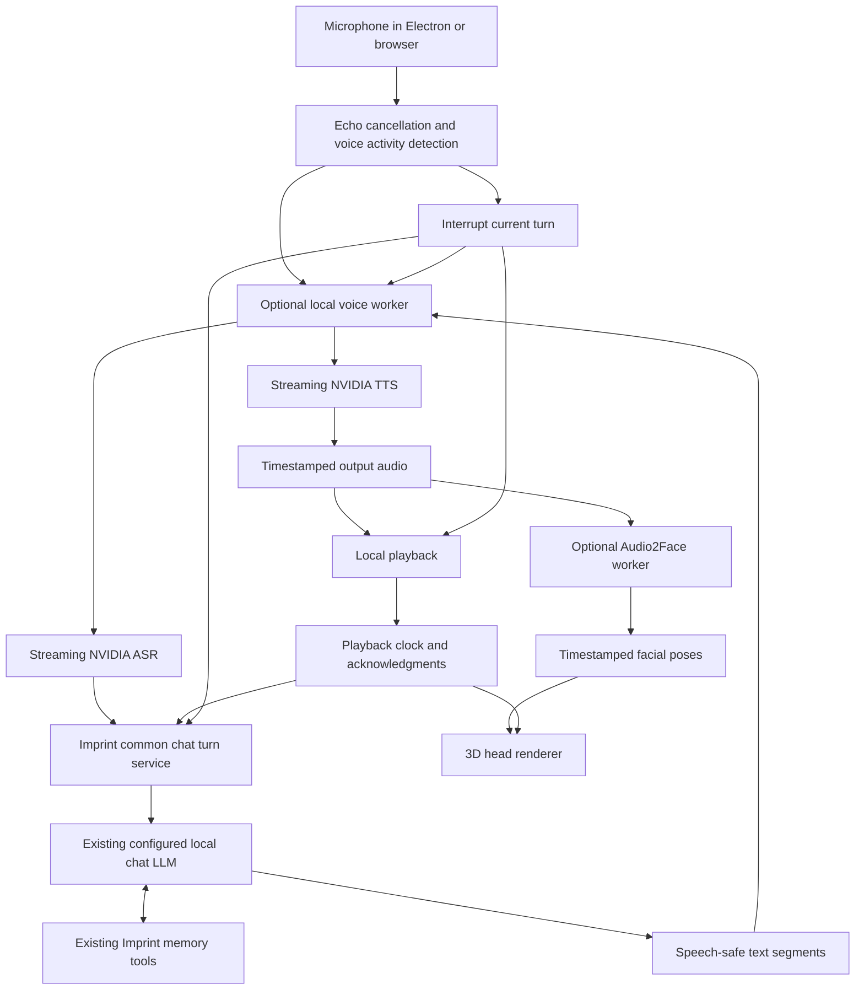

## Assessment and scope

Reviewed **2026-10-24**, against Imprint commit `bbbbb1f` and the upstream sources linked below. **Status: research proposal, not an accepted architecture or implemented feature.** Upstream default branches are moving references; implementation must pin revisions and model hashes.

**Feasible:** an optional floating 3D head that listens, answers through the same local LLM and memory tools as dashboard chat, speaks incrementally, and stops when the user talks over it. The recommended first implementation is a streaming ASR → existing Imprint chat agent → streaming TTS pipeline, with local avatar rendering and optional NVIDIA Audio2Face animation.

**Conditional:** consistently fast responses with all models resident on a laptop GPU, robust speakerphone interruption, natural backchannels, Romanian speech output, and identical desktop behavior across platforms. These need measured prototypes. An interruptible cascade can listen during playback and cancel speech; it does not automatically reproduce a speech model's learned simultaneous dialogue, prosody or backchannels.

Confirmed language scope: **English first**, selected by the user on 2026-10-24. Romanian and other languages are future options. Planning assumptions: one active voice conversation, explicit session activation, and a head floating above other desktop applications. A browser dashboard can host an in-page avatar; an operating-system overlay belongs in Electron. No voice models, audio devices, installers, real client profiles or user memories were exercised in this assessment.

## Which NVIDIA project fits?

| Project | What it provides | Fit for Imprint |
| --- | --- | --- |
| PersonaPlex | A full-duplex speech-to-speech conversational model | Likely the interruptible assistant the request refers to. It includes its own conversational model, rather than serving as interchangeable ears and a voice for Qwen. |
| Nemotron Voice Agent Blueprint | A Pipecat-based streaming ASR/LLM/TTS reference pipeline with interruption handling and replaceable components | Closest architectural reference for retaining Imprint's existing chat agent. Adapt the media orchestration, rather than importing its entire deployment. |
| NeMo-Speech.cpp | Native local speech inference, including separate ASR and TTS services | First runtime candidate for lightweight local NVIDIA speech components; benchmark a pinned release before adoption. |
| Audio2Face-3D SDK | Audio-driven facial animation | Suitable optional animation backend. It does not supply the assistant's reasoning, speech recognition, speech synthesis, renderer or custom avatar asset. |

PersonaPlex listens and generates speech concurrently. Its code is MIT; its weights use the NVIDIA Open Model License and require accepting model access terms. The published interface conditions its own speech model with role and voice prompts. **Inference from that architecture:** retaining an arbitrary existing GGUF chat model is not a documented drop-in substitution. Making Qwen a backend advisor would introduce two conversational models and an unproven coordination path. [PersonaPlex repository](https://github.com/NVIDIA/personaplex), [model card](https://huggingface.co/nvidia/personaplex-7b-v1).

The current NVIDIA blueprint explicitly demonstrates a cascaded, interruptible pipeline. Its older `NVIDIA/voice-agent-examples` repository was archived in July 2026 and points to the blueprint. Use the maintained project as a reference. [Nemotron Voice Agent](https://github.com/NVIDIA-AI-Blueprints/nemotron-voice-agent), [archived examples](https://github.com/NVIDIA/voice-agent-examples).

NeMo-Speech.cpp advertises standalone streaming recognition, Magpie synthesis, CPU/GPU execution and Apache-2.0 NVIDIA-authored code. Its integrated Nemotron Labs VoiceChat mode is another complete speech conversational model; its guide asks for at least 16 GB GPU-accessible memory for the recommended quantization. That mode also changes the conversational model and is outside the recommended first implementation. [Runtime](https://github.com/NVIDIA/NeMo-Speech.cpp), [VoiceChat guide](https://github.com/NVIDIA/NeMo-Speech.cpp/blob/main/docs/s2s/README.md).

### Using PersonaPlex with Imprint MCP

Imprint can supply memory independently of its dashboard chat LLM: an MCP client can call retrieval and explicit storage tools without passing through Qwen. That makes PersonaPlex plus Imprint memory conceptually possible, while changing the original requirement to retain the same chat model. [Imprint MCP](mcp.md).

However, stock PersonaPlex has no native tool-calling interface. LiveKit's current PersonaPlex integration explicitly lists no function/tool calling, no user transcription and no prior-history loading. The inspected NVIDIA server accepts a text prompt at connection setup and incoming audio frames; it has no live tool-result message handler. A generic MCP client alone does not solve that missing model interface. [LiveKit limitations](https://docs.livekit.io/agents/models/realtime/personaplex/#considerations), [NVIDIA server source](https://github.com/NVIDIA/personaplex/blob/main/moshi/moshi/server.py).

Two different scopes follow. A bounded prototype can retrieve selected project memories through MCP **before** connecting, then include that evidence in PersonaPlex's initial text prompt. Dynamic search and saving during conversation require a custom bridge: separate speech transcription, a tool router or tool-capable model, and a validated way to deliver fresh evidence into PersonaPlex's conversation state. That last part needs runtime changes or another evaluated mechanism; reconnecting with a new prompt is not seamless live context injection. Do not promise grounded live memory answers or reliable writes from prompting alone. Keep this alternative in the research phase until an end-to-end demonstration succeeds.

## What Imprint already has

Implementation follow-up, 2026-10-24: branch `feat/personaplex-voice` adds the [experimental startup-snapshot adapter](personaplex-prototype.md), recorded in [ADR 0041](adr/0041-personaplex-startup-memory-prototype.md). It does not implement the complete cascade/voice/avatar design below or establish real speech performance.

| Existing source | Reusable behavior | Required extension |
| --- | --- | --- |
| [`imprint/chat.py`](../imprint/chat.py) | `stream_reply`, provider selection, token events and the shared memory-tool loop | Cancellation through generation and tools; a voice response style; speech-safe events |
| [`imprint/local_llm.py`](../imprint/local_llm.py) | Cached local GGUF model and shared inference lock | Interactive admission, cancellation checkpoints and measured lock-release behavior |
| [`imprint/api.py`](../imprint/api.py) | `/api/chat` SSE, tool events and persistence | A common turn service used by both text and voice; authenticated local voice sessions |
| [`imprint/chat_store.py`](../imprint/chat_store.py) | Per-workspace SQLite sessions and messages | Interrupted-turn and played-audio metadata, with an additive migration |
| [`imprint/ui/src/app/chat/page.tsx`](../imprint/ui/src/app/chat/page.tsx) | Transcript UI and client-side abort | Shared session display, microphone controls and playback state |
| [`ui-electron/main.js`](../ui-electron/main.js), [`preload.js`](../ui-electron/preload.js) | Sandboxed frameless desktop shell, tray and owned API lifetime | Separate avatar window, narrow IPC, microphone permission handling and voice lifetime |

The documented default helper is Qwen3.5-4B Q4_K_M, an approximately 2.74 GB GGUF with an 8192-token context. Chat, summaries and tagging can share a model **within the same process** when settings match; their inference is serialized. Separate processes can still load additional instances. GPU layers configured in settings do not establish that the installed binding actually accelerates inference. [Local models](local-models.md).

Today, chat records generated text as it streams and preserves partial text on early stream closure. There is no explicit end-to-end voice cancellation token or playback acknowledgment. Browser abort therefore needs integration testing; it does not establish prompt interruption of a native inference call or an already-running tool. Generated text is also different from speech the user actually heard.

## Proposed architecture

Recommended responsibilities:

1. **Imprint remains the conversation authority.** Extract a reusable turn service from the existing API generator. It owns workspace binding, history, tool execution and the existing model instance. Voice submits finalized recognized turns to it and consumes its events. Do not instantiate another Qwen model in a voice worker or route only to a raw completion endpoint that bypasses Imprint's tools.
2. **Use an optional media worker.** Evaluate Pipecat for turn detection, streaming, TTS buffering and interruption propagation, with a custom processor that bridges to Imprint's turn service. Keep Pipecat's media context subordinate to Imprint's authoritative transcript; it must not run a second tool loop. NVIDIA's blueprint is a reference, not a dependency on its default LLM or cloud endpoints. The spike must verify that cancellation crosses this custom bridge.
3. **Keep speech and animation runtimes isolated.** First evaluate NeMo-Speech.cpp ASR/TTS as a local native service. Run Audio2Face in its own process with its required libraries. Neither should alter Imprint's base Python dependency environment. Reuse independently started services without assuming ownership; stop only workers Imprint started.
4. **Start with local WebSocket media.** Use binary PCM frames, negotiated sample rates, bounded queues and JSON control events through an Imprint-controlled endpoint. Capture/playback stays in Chromium; prototype a small AudioWorklet buffer. WebRTC transport is a follow-up if measured echo, jitter or device behavior warrants its extra setup. Neither choice removes the need to test acoustic echo cancellation on real speakers.
5. **Make voice follow the selected chat provider explicitly.** The intended mode uses the existing local provider. If the user later selects a hosted chat provider, show that routing change before sending recognized speech text there; do not silently promise a fully local conversation.

Proposed control events include `speech_started`, `transcript_partial`, `transcript_final`, `reply_delta`, `audio_chunk`, `face_frame`, `playback_ack`, `interrupt`, `turn_cancelled` and `error`. These are design names, not existing endpoints. Bind every event to an immutable workspace, session, turn and generation identifier, plus sequence numbers and audio timestamps. Changing workspace ends or explicitly rebinds the voice session. Only one window owns microphone capture and audible playback; other windows observe session state.

## Speech and avatar choices

For English ASR, first test **Nemotron Speech Streaming EN 0.6B**, which is explicitly designed for cache-aware streaming English transcription. For TTS, first test **MagpieTTS Multilingual 357M** through the native runtime. Both weights use NVIDIA Open Model terms. Magpie's current v2607 card lists 12 languages, excluding Romanian, and is a dedicated text-to-speech layer suitable for a cascade. [ASR card](https://huggingface.co/nvidia/nemotron-speech-streaming-en-0.6b), [TTS card](https://huggingface.co/nvidia/magpie_tts_multilingual_357m).

For a future Romanian option, **Parakeet TDT 0.6B v3** includes Romanian recognition and declares CC-BY-4.0 weights. Its published multilingual transcription support does not by itself establish suitable incremental turn latency. That expansion would need testing of the runtime's streaming/windowing behavior and a separately evaluated Romanian TTS provider. It is outside the English-first delivery scope. [Parakeet card](https://huggingface.co/nvidia/parakeet-tdt-0.6b-v3).

Render a licensed, rigged GLB head locally with Three.js, optionally through React Three Fiber. Authoring a recognizable custom head and its facial poses is a separate asset task. Begin with blinking, subtle idle movement and a simple jaw/viseme fallback. An image of a face alone is not a rigged 3D asset.

Audio2Face's SDK is MIT, while its pretrained models have separate NVIDIA Open Model terms. It supports interactive processing on Windows/Linux using CUDA/TensorRT. The inspected SDK specifies CUDA `>=12.8,<13`, TensorRT `>=10.13,<11` and Python 3.8–3.10 for its tooling. Imprint uses Python 3.12 and a CUDA 13 ONNX GPU profile, so in-process installation is a poor default. Process isolation avoids forcing one library stack onto the other; compatibility still needs testing. [Audio2Face SDK](https://github.com/NVIDIA/Audio2Face-3D-SDK), [Imprint build/runtime policy](building.md), [ADR 0038](adr/0038-gpu-runtime-ships-cuda-libraries.md).

Feed Audio2Face **assistant output audio**, not the microphone, and adapt its poses to the chosen head rig. The Mark v2.3 card describes facial-pose output and resampling to 16 kHz; do not assume every SDK/model path directly produces the avatar's exact ARKit morph-target names. Verify or build the retargeting/pose-to-blendshape mapping. Measure required audio lookahead and animation delay, and synchronize both streams to actual playback. If animation misses its deadline, fall back rather than stall speech. [Mark model card](https://huggingface.co/nvidia/Audio2Face-3D-v2.3-Mark).

Use a second, small Electron window for the desktop head: transparent, frameless, draggable, with opt-in always-on-top behavior, mute/stop/hide controls and accessible status text. Transparency alone does not make empty areas click-through; hit testing needs its own implementation. Keep an in-dashboard fallback. Native Windows, macOS and Linux compositor behavior must be validated separately. [Electron window styles](https://www.electronjs.org/docs/latest/tutorial/custom-window-styles).

## Interruption is the main engineering contract

Pipecat already describes cancellation of model/TTS work, flushing output audio and retaining spoken-so-far context. Those semantics are useful, but a custom Imprint processor must implement cancellation itself. [Pipecat interruptions](https://docs.pipecat.ai/pipecat/fundamentals/interruptions).

When user speech starts during a reply:

1. Stop local playback immediately and invalidate the current generation identifier. Do this before waiting for final ASR text or a backend acknowledgment.
2. Flush pending audio, unsent TTS text and queued facial animation. Return the mouth to a listening/neutral pose.
3. Signal cancellation through the media worker and Imprint turn service. Check cancellation before generation, between output chunks, before starting a tool and before another tool iteration. Ensure nested generators close and inference locks are released on the owning worker thread.
4. Continue capturing the new utterance, including a short preroll so its first syllable is preserved. Once the old worker releases the model, start the new finalized turn.
5. Reject stale packets and late tool-driven speech. Do not replay discarded audio after reconnect.

Stopping playback and freeing the model are separate deadlines. A native prompt evaluation may not stop at an ordinary Python cancellation point. Measure token/prefill cancellation and any available runtime abort mechanism; if bounded cancellation cannot be achieved, explicitly report the delay or use a dedicated inference worker with a controlled restart path. Do not kill the shared API to interrupt speech.

Keep microphone input active while speaking, with echo cancellation/noise suppression and tested speech-start thresholds. Headphones simplify the first prototype; speakerphone testing is a release gate. Include silence, coughs, brief acknowledgments and an explicit “stop.” Sophisticated backchannel discrimination is a later quality milestone.

Distinguish generated, synthesized and **played** text. Playback acknowledgments should commit only heard speech into the next voice prompt, conservatively at chunk boundaries when word alignment is unavailable. Preserve any generated-only text separately if useful for the chat UI. Mark interruption explicitly. Persist successful tool outcomes even if speech was interrupted: cancellation cannot undo a completed memory write or URL ingestion. Serialize writes per session, and do not retry a completed side effect because its spoken acknowledgment was lost.

Convert speech-safe text incrementally using bounded clause/sentence segments. Never speak tool markup, tool-result payloads or provisioning logs. Handle Markdown, citations, code and URLs deliberately; avoid reading long code blocks aloud. The stored answer can retain richer text than its spoken presentation.

## Hardware, latency and platform feasibility

A read-only `nvidia-smi` query in this workspace exposed an **RTX 4080 Laptop GPU, 12,282 MiB VRAM**, plus a GTX 1060 with 6144 MiB, driver 581.80, under WSL2. This is device visibility, not a voice benchmark. Select the target GPU explicitly; the two memory capacities are not one shared pool, and the older GPU requires its own backend compatibility checks.

The modular pipeline is a promising candidate on the 12 GB device with the 4B quantized chat model. File size is not peak VRAM: include KV cache, prompt buffers, speech models/codecs, TensorRT workspaces, graphics rendering and other processes. Measure the full concurrent pipeline. Try CPU ASR/TTS or lower chat GPU offload if contention demands it; keep embeddings on their documented CPU default initially. Background summaries/tagging need an admission policy so they cannot monopolize the shared helper while a voice turn is waiting. Separate processes also need resource budgeting because the Python inference lock is process-local.

PersonaPlex is a less comfortable starting point on that GPU: **rough estimate**, 7 billion weights at two bytes each are about 14 GB before codecs, caches and buffers. Upstream supports CPU offload, but that does not guarantee real-time behavior here. Neither this estimate nor the VoiceChat guide's 16 GB recommendation establishes a measured hardware minimum for every alternative configuration.

Proposed warm-session targets, to be measured rather than advertised:

| Measurement | Initial target |
| --- | --- |
| End of user speech → first audible answer, without a tool | p50 ≤1.2 s; p95 ≤2 s |
| Physical user speech onset → audible stop | p95 ≤250 ms, including detection |
| Detected speech start → local audio flush | p95 ≤100 ms |
| Cancellation acknowledgment and model availability | Measure separately; aim for ≤500 ms in ordinary token generation; report prefill/tool exceptions |
| Continuous ASR and TTS | Each sustains faster-than-real-time processing under concurrent load |
| Mouth/audio synchronization | Aim for absolute offset ≤80 ms |
| Stability | 30-minute session, repeated interrupts, no monotonic queue/memory growth |

Attribute response latency to endpoint detection + ASR finalization + lock wait + LLM time to first speakable segment + TTS startup + playback buffer. A representative planning budget is 250 + 100 + 0 + 350 + 200 + 100 = 1000 ms; it is not an observed result. Tool execution adds its own time. Cold model loads/downloads are separate setup states. Visual working status can cover long tools; any spoken progress cue should be explicit and limited.

Native Windows with an NVIDIA GPU is a sensible first desktop target for this machine. WSL2 can host development services, but a WSL GPU query does not validate Windows microphone permissions, transparent windows, installers or audio routing. Native Linux/NVIDIA is a second validation target. On macOS, use an alternate speech backend and simpler facial animation unless a separately hosted NVIDIA service is selected; the inspected Audio2Face SDK does not provide a native macOS runtime. Browser-only use supports an in-page head. None of these voice/platform combinations has been executed in this assessment.

## Local boundaries and installation

Voice adds microphone access and a bidirectional endpoint. Existing HTTP middleware in `api.py` does not automatically protect a new WebSocket handler: validate the connection peer, Host and exact allowed dashboard Origin during the handshake, then require a short-lived session capability. Apply limits to frame size, rate, session duration and buffering. Keep media services on loopback, authenticated to Imprint, with no automatic public binding or cloud fallback. Retain the existing container exception only through an explicit, documented design. [ADR 0024](adr/0024-enforce-local-service-boundaries.md).

Authorize microphone capture only for the expected Imprint renderer and an explicitly active session, retaining sandboxing, context isolation and narrow IPC sender validation. Show a persistent listening indicator and provide immediate mute. Default raw audio to transient memory; persist finalized chat text according to existing session behavior, with diagnostics/audio recording separately opt-in. Review OS microphone permission and packaging metadata on each supported platform. [Electron security guidance](https://www.electronjs.org/docs/latest/tutorial/security).

Make speech/animation an optional install with pinned downloads, hashes, license notices, progress, bounded model-cache ownership and recoverable setup. Check model access terms before provisioning; never bundle a personal token. Support repair, update and uninstall without disturbing other client settings or memories. Define whether closing the avatar ends voice; proposed default is yes, while hiding the main dashboard may leave an explicitly active avatar session running. Explicit Quit and renderer crashes must stop microphone capture and release owned media workers. [Desktop ownership](adr/0025-desktop-owned-background-service.md).

## Implementation plan and decision gates

Estimates are engineering working days for one experienced developer using an available rigged head and English speech. They include integration and focused validation, not custom character production or waiting for hardware access. Phases 0–4 are approximately **19–30 days**; multi-platform packaging and release hardening bring the total to approximately **26–42 days (5–9 working weeks)**. Revisit after the initial spike.

| Phase | Work and likely touchpoints | Exit evidence | Estimate |
| --- | --- | --- | --- |
| 0: Resolve technical uncertainty | Isolated pinned ASR/TTS and Audio2Face samples; exercise the existing local chat model; compare CPU/GPU placement, English speech quality and rig mapping | Concurrent latency/VRAM report, model/license inventory, runtime decision; no real profiles or memories used | 2–3 days |
| 1: Shared cancellable turns | Refactor `api.py`/`chat.py`; cancellation and scheduling in `local_llm.py`; explicit session/workspace ownership; additive persistence migration | Text chat parity, deterministic abort at generation/tool boundaries, no duplicate stores, correct played-text history | 4–6 days |
| 2: Voice without avatar | Optional Pipecat/media worker, speech-runtime adapter, local voice API, capture/playback and microphone UI | Same model and memory tools as chat; first audible replies meet measured targets; final transcripts saved once | 5–8 days |
| 3: Interruption quality | Echo handling, local-first stop, queue flush, generation IDs, playback acknowledgments, device/reconnect handling | Interrupt while generating/synthesizing/playing/using tools; speaker and headphone trials; 30-minute stability run | 4–6 days |
| 4: Floating head | New client-only avatar view, head asset/rig, renderer, Audio2Face adapter, Electron overlay and IPC | Lip sync follows playback; interruption stops mouth motion; avatar works with main dashboard hidden; fallback works | 4–7 days |
| 5: Distribution and platform gates | Optional provisioning, pinned artifacts, native permission/installer work, lifecycle tests, documentation | Disposable native Windows/Linux validation and explicitly documented macOS alternatives/limitations; update/uninstall checks | 7–12 days |
| 6: Optional research | PersonaPlex or integrated VoiceChat comparison, wake word, backchannels, broader languages and custom character work | Separate proposal and measurements; no implied delivery date | Separate scope |

Before implementing runtime, storage, security or installer changes, record proposed ADRs with alternatives, consequences and validation plans. Accept them only with the implementation and evidence; preserve the existing ADR rationale. Update API/configuration/local-model/building/platform docs as behavior lands. This feasibility document alone makes no runtime or schema decision effective.

Recommended first milestone: **prove one local voice turn through the existing chat agent, interrupt it reliably, and measure it on the RTX 4080 before investing in the finished head.** Continue to the avatar once cancellation, speech quality and hardware headroom pass. If the main priority instead becomes PersonaPlex's learned conversational behavior, treat that as an explicit change to the same-chat-model requirement.
