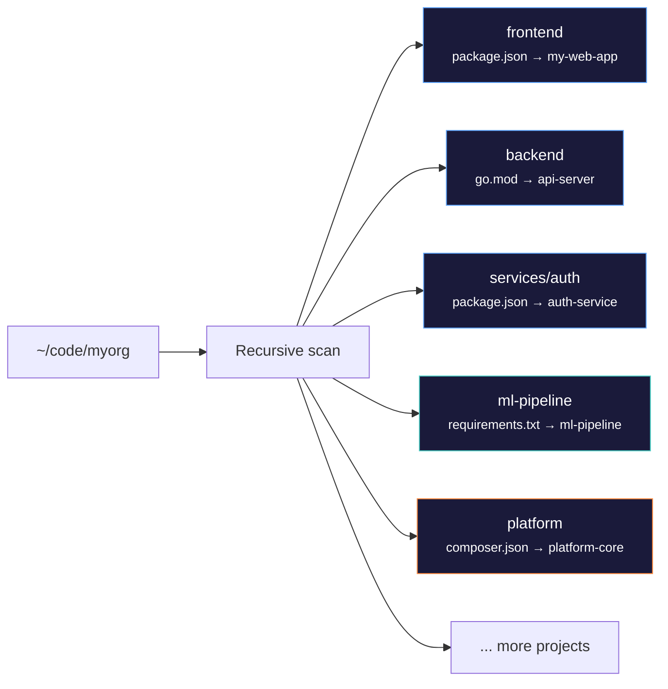
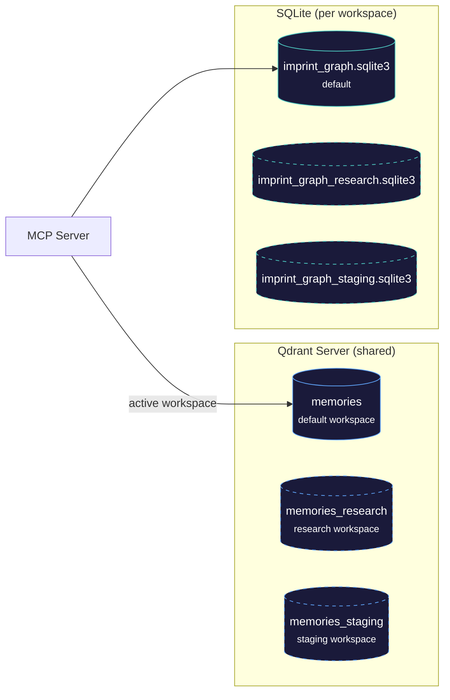

## Project Detection

When you run `imprint ingest ~/code`, it recursively finds real project roots by looking for manifest files — not just top-level directories:



| Manifest | Type | Name extracted from |
|---|---|---|
| `package.json` | Node.js | `name` field |
| `go.mod` | Go | `module` path |
| `pyproject.toml` / `setup.py` | Python | `name` field or dir name |
| `requirements.txt` | Python | directory name |
| `composer.json` | PHP | `name` field |
| `Cargo.toml` | Rust | `name` field |
| `pom.xml` / `build.gradle` | Java | directory name |
| `Gemfile` | Ruby | directory name |

Projects are identified by **canonical name** from the manifest, not the file path. The same project at different paths on different machines gets the same identity — this makes sync work across machines.

Files outside any manifest go into a fallback project named after the ingested folder: ingesting `~/Desktop` creates a project `Desktop`.

## Move memories between projects

A catch-all project such as `Desktop` can be sorted afterwards. On the dashboard's **Projects** page, pick a project, select sources and choose **Move selected…**. Use **Move or merge…** to move the whole project; moving into an existing project merges into it. Either way you review what moves before confirming. From the CLI:

```bash
imprint move Desktop branding --source "Desktop/Naming Questionnaire.pdf"           # preview
imprint move Desktop branding --source "Desktop/Naming Questionnaire.pdf" --apply
imprint move imprint-memory-layer imprint --apply                                   # merge a whole project
```

The project a memory's writer named (ingestion from the folder, learning from the conversation's directory, an agent from its argument) is its *origin project*. A move records a rule in this workspace's policy: the origin project, or one of its sources, goes to the target. Every write applies these rules, so refresh, learning and sync keep moved memories where you put them. Merging a whole project also sends memories saved later under its old name to the target.

- Source keys do not change. A moved file keeps `Desktop/<file>`, which records where it was indexed. Graph facts, purge and `file_chunks` keep working. The file stays where it is, so refresh the folder it lives in to pick up edits.
- Vectors are reused, but logical IDs change, because they include the project.
- Rules belong to this device's workspace, like roots and exclusions, and are not synced. A paired device keeps its own layout. Copies it sends back are placed by your rules, so they do not undo the move. Make the same move there for the same layout.
- To undo, move the sources back. For a merge, move back the sources whose keys start with the old project's name.

Moves preview by default, share the ingestion lock, and apply only to the workspace that was previewed. See [ADR 0036](adr/0036-move-memories-between-projects.md).

## Workspaces

Workspaces provide isolated memory environments. Each workspace gets its own Qdrant collection, SQLite knowledge graph, and write-ahead log — complete data isolation on the same Qdrant server.



**Default workspace** (`default`) uses the same file and collection names as before — zero migration. Existing data is automatically in the default workspace.

```bash
# List workspaces
imprint workspace
#   default (active)

# Create and switch to a new workspace
imprint workspace switch research
#   [+] created and switched to workspace: research

# Ingest into the active workspace — data goes to `memories_research` collection
imprint ingest ~/code/research-project

# Switch back
imprint workspace switch default

# Delete a workspace (must not be active)
imprint workspace delete research
```

In the dashboard, the workspace menu at the top right of every page shows the active workspace, switches to another one (the dashboard reloads) and creates one. **Manage workspaces** in that menu lists every workspace with its roots and lets you create, switch, edit roots, wipe, copy/move memories and delete. Deleting requires typing the workspace name and is unavailable for `default` and for the active workspace.

**Naming rules:** lowercase alphanumeric + hyphens, max 40 characters, must start with letter or digit.

**Data per workspace:**

| Workspace | Collection | SQLite | WAL |
|---|---|---|---|
| `default` | `memories` | `imprint_graph.sqlite3` | `wal.jsonl` |
| `research` | `memories_research` | `imprint_graph_research.sqlite3` | `wal_research.jsonl` |

**Wipe behavior:**

```bash
imprint wipe                       # wipe active workspace only (via API — no server restart)
imprint wipe --workspace research  # wipe a specific workspace
imprint wipe --all                 # stop Qdrant, delete all data, restart fresh
```

The MCP process pins its default workspace at startup, so another window's `workspace switch` cannot redirect it. Restart the client connection after switching, set `IMPRINT_WORKSPACE` in the client's server environment, or pass a tool's explicit `workspace`. CLI ingestion captures its workspace before waiting/queueing. Selection is stored in `data/workspace.json`.

## Copy, move and share a workspace

`imprint migrate` transfers memories between workspaces by project, topic or exact source, keeping their vectors, so both workspaces need the same embedding profile. It moves by default. `--copy` leaves the source untouched, which is how you curate a workspace to share without taking anything out of your own:

```bash
imprint migrate --from default --to team --project payments-api --copy --dry-run
imprint migrate --from default --to team --project payments-api --copy
imprint migrate --from default --to team --topic auth --copy
```

A real run registers a new target workspace without switching to it; a dry run changes nothing, not even the target. Project and source transfers also copy the knowledge-graph facts about the transferred memories' sources, including files moved into the project from another one (topic transfers copy none); facts are never removed from the source and facts the target already holds are skipped, so re-running a copy refreshes the curated workspace without duplicates. A copy does not delete: memories you later remove from the source stay in the target until you remove them there. The dashboard's **Copy / move memories…** dialog (workspace menu → **Manage workspaces**, or **Settings → Workspaces**) offers the same choice and defaults to **Copy**.

Live sync works on one workspace, end-to-end encrypted, and never switches the active one. `imprint sync serve --workspace team --send-only` shares only `team`, read-only, and prints a share code; the joining machine runs `imprint sync <code>` and picks its own destination with `--workspace` (created when the data arrives). Joining only receives unless it adds `--two-way` or `--send-only`, and then it is shown the serving device and asked before anything is sent. See [sync](sync.md#share-part-of-your-memory) and [ADR 0016](adr/0016-sync-direction-and-workspace-sharing.md).

## Approved roots and sharing

The first ingest binds a directory (a single file binds its parent). Later ingest/refresh targets must stay inside approved roots. Additional roots require explicit approval:

```bash
imprint workspace roots
imprint workspace roots add /code/my-project --workspace research
imprint workspace roots add /code/shared --workspace research --allow-overlap
imprint workspace roots remove /code/my-project --workspace research
```

Roots resolve symlinks and use path-component boundaries. An overlap error identifies the other workspaces; `--allow-overlap` explicitly confirms sharing. The dashboard offers the same action with confirmation under **Sources → Workspace roots and cleanup** for the active workspace, and under **Manage workspaces → Edit** for any workspace. Removing a root retains indexed data. Policy is stored separately in `data/workspace-policy.sqlite3`.

An ingest or refresh started from the dashboard (quick actions, Commands) that the roots would refuse is checked before it is queued. Instead of a job that fails later, the dashboard asks whether to approve the folder as a root of the active workspace and names any other workspace that already has it, so approving confirms that sharing. Once approved, the job is submitted again. Declining queues nothing.

**Pick folder** browses the machine the Imprint service runs on, with breadcrumbs in that machine's path syntax. On a Windows installation it lists each WSL distribution as a root (for example **WSL Ubuntu** at `\\wsl.localhost\Ubuntu\`), so Linux folders can be picked and approved. These are the same `\\wsl.localhost\<distro>\…` paths that WSL clients connected to the Windows runtime use (ADR 0026). A root typed as `\\wsl$\<distro>\…` is a different path for the comparison and does not cover them. Linux-style paths such as `/home/me` are not guessed on Windows.

Existing data is retained; old provenance does not automatically establish ownership. Approve intended roots and purge mistakes. Inline/URL content and deliberate migrations use the selected workspace directly.

### Learning needs no root

`imprint learn` reads the stores of the clients Imprint is integrated with, so it needs no approved root. These are Claude Code's transcripts and auto-memory files, Codex's sessions, Cursor's agent conversations, GitHub Copilot's sessions and Cline's sessions on this computer, the same from every client profile registered in WSL, and the Downloads folders where desktop exports land. Roots decide which workspace each conversation belongs to. A conversation is learned when every working directory it recorded is inside this workspace's roots or outside every other workspace's roots. Claude Code records a working directory with each entry, Codex records one per session and turn, and Copilot records one when a session starts, resumes or changes context. Cursor records none; its conversation folder's name counts as the working directory when exactly one existing directory has that name. Cline records a session's working directory and workspace root in the session's manifest. A WSL conversation's directories are compared in the `\\wsl.localhost\<distro>\…` and drive-path form the WSL bridge uses. Conversations about another workspace's projects stay there, and conversations with no recorded working directory are skipped. Auto-memory files and the Stop hook follow the same rule. Desktop exports are tracked per workspace. Extra export folders passed with `--path` must be inside approved roots. See [ADR 0034](adr/0034-learn-from-client-stores-by-conversation-ownership.md), [ADR 0037](adr/0037-learn-every-integrated-client-store.md), [ADR 0052](adr/0052-learn-cursor-conversations-from-their-folder-names.md), [ADR 0056](adr/0056-learn-cline-sessions-from-their-manifests.md) and [ADR 0057](adr/0057-copilot-home-as-store-config-and-hook-root.md).

## Purge mistaken files or directories

Preview the scope/count, then apply to the same workspace:

```bash
imprint purge /code/wrong-project --workspace research
imprint purge /code/wrong-project --workspace research --apply
# Use --recursive for a deleted directory whose type cannot be detected.
imprint purge /code/deleted --recursive --workspace research --apply
# Logical source keys also work for legacy or foreign-machine provenance.
imprint purge project/private-dir --source --recursive --workspace research
imprint purge project/private-dir --source --recursive --workspace research --apply
imprint workspace exclusions --workspace research
imprint workspace exclusions restore project/private-dir --source --workspace research
```

Purge removes indexed chunks and source-linked graph facts from that workspace. Original files and other workspaces stay intact. Directory matching preserves similarly named siblings. Apply records an exclusion so refresh and sync/import cannot silently restore those sources. **Allow re-ingestion** in the dashboard, or `workspace exclusions restore`, removes that exact exclusion; reindex afterward.

The Sources panel supports path/source selection, recursion, count/sample preview and typed workspace confirmation. MCP `purge_sources` defaults to preview; agents must obtain user confirmation and name the reviewed workspace for apply. Cleanup does not load embeddings and works on old-model collections. Partial failures remain visible and preserve the protective exclusion for retry. Backups, exported bundles and logs are not erased. See [ADR 0015](adr/0015-workspace-roots-and-source-purge.md).

## Device-aware project paths

Shared conversation/project memories remain available on every device. `imprint workspace map <project> <local-directory>` maps portable project-relative references to this device’s approved checkout; file ingestion sets the map automatically. Original paths stay labelled as references, and foreign paths are never pruned by probing this machine. See [devices and portable project paths](devices.md).
