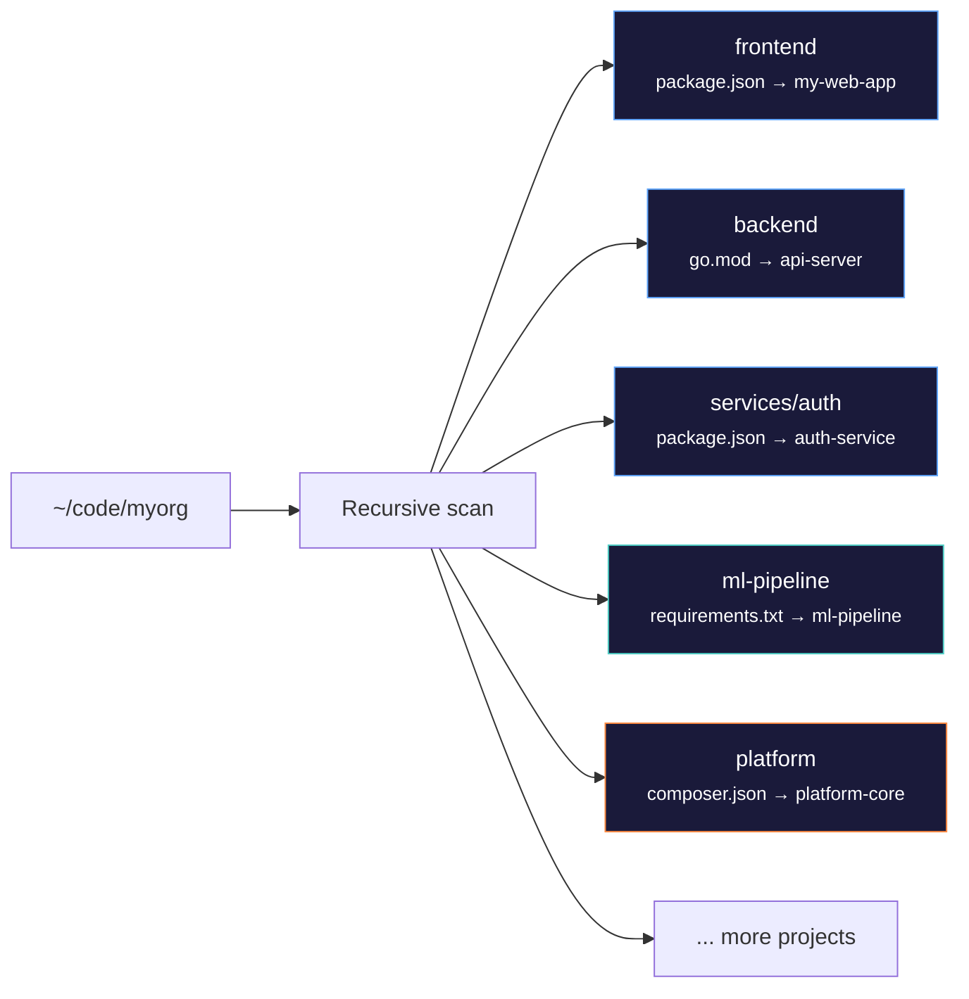
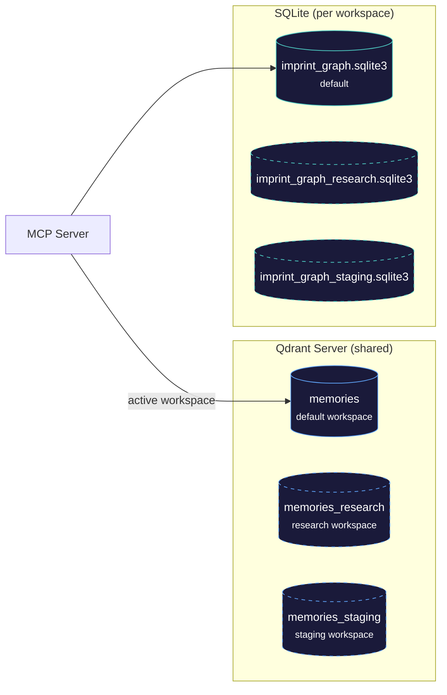

## Project Detection

When you run `imprint ingest ~/code`, it recursively finds real project roots by looking for manifest files — not just top-level directories:



| Manifest | Type | Name extracted from |
|---|---|---|
| `package.json` | Node.js | `name` field |
| `go.mod` | Go | `module` path |
| `pyproject.toml` / `setup.py` | Python | `name` field or dir name |
| `requirements.txt` | Python | directory name |
| `composer.json` | PHP | `name` field |
| `Cargo.toml` | Rust | `name` field |
| `pom.xml` / `build.gradle` | Java | directory name |
| `Gemfile` | Ruby | directory name |

Projects are identified by **canonical name** from the manifest, not the file path. The same project at different paths on different machines gets the same identity — this makes sync work across machines.

## Workspaces

Workspaces provide isolated memory environments. Each workspace gets its own Qdrant collection, SQLite knowledge graph, and write-ahead log — complete data isolation on the same Qdrant server.



**Default workspace** (`default`) uses the same file and collection names as before — zero migration. Existing data is automatically in the default workspace.

```bash
# List workspaces
imprint workspace
#   default (active)

# Create and switch to a new workspace
imprint workspace switch research
#   [+] created and switched to workspace: research

# Ingest into the active workspace — data goes to `memories_research` collection
imprint ingest ~/code/research-project

# Switch back
imprint workspace switch default

# Delete a workspace (must not be active)
imprint workspace delete research
```

**Naming rules:** lowercase alphanumeric + hyphens, max 40 characters, must start with letter or digit.

**Data per workspace:**

| Workspace | Collection | SQLite | WAL |
|---|---|---|---|
| `default` | `memories` | `imprint_graph.sqlite3` | `wal.jsonl` |
| `research` | `memories_research` | `imprint_graph_research.sqlite3` | `wal_research.jsonl` |

**Wipe behavior:**

```bash
imprint wipe                       # wipe active workspace only (via API — no server restart)
imprint wipe --workspace research  # wipe a specific workspace
imprint wipe --all                 # stop Qdrant, delete all data, restart fresh
```

The MCP process pins its default workspace at startup, so another window's `workspace switch` cannot redirect it. Restart the client connection after switching, set `IMPRINT_WORKSPACE` in the client's server environment, or pass a tool's explicit `workspace`. CLI ingestion captures its workspace before waiting/queueing. Selection is stored in `data/workspace.json`.

## Copy, move and share a workspace

`imprint migrate` transfers memories between workspaces by project, topic or exact source, keeping their vectors, so both workspaces need the same embedding profile. It moves by default. `--copy` leaves the source untouched, which is how you curate a workspace to share without taking anything out of your own:

```bash
imprint migrate --from default --to team --project payments-api --copy --dry-run
imprint migrate --from default --to team --project payments-api --copy
imprint migrate --from default --to team --topic auth --copy
```

A real run registers a new target workspace without switching to it; a dry run changes nothing, not even the target. Project and source transfers also copy their source-linked knowledge-graph facts (topic transfers have none); facts are never removed from the source and facts the target already holds are skipped, so re-running a copy refreshes the curated workspace without duplicates. A copy does not delete: memories you later remove from the source stay in the target until you remove them there. The dashboard's **Settings → Workspaces → Copy / move…** dialog offers the same choice and defaults to **Copy**.

Live sync works on one workspace, end-to-end encrypted, and never switches the active one. `imprint sync serve --workspace team --send-only` shares only `team`, read-only; the joining machine picks its own destination with `--workspace` (created when the data arrives) and can add `--receive-only`. See [sync](sync.md#share-part-of-your-memory) and [ADR 0016](adr/0016-sync-direction-and-workspace-sharing.md).

## Approved roots and sharing

The first ingest binds a directory (a single file binds its parent). Later ingest/refresh targets must stay inside approved roots. Additional roots require explicit approval:

```bash
imprint workspace roots
imprint workspace roots add /code/my-project --workspace research
imprint workspace roots add /code/shared --workspace research --allow-overlap
imprint workspace roots remove /code/my-project --workspace research
```

Roots resolve symlinks and use path-component boundaries. An overlap error identifies the other workspaces; `--allow-overlap` explicitly confirms sharing. The dashboard's **Sources → Workspace roots and cleanup** panel offers the same action with confirmation. Removing a root retains indexed data. Policy is stored separately in `data/workspace-policy.sqlite3`.

Existing data is retained; old provenance does not automatically establish ownership. Approve intended roots and purge mistakes. `learn` requires roots first, imports transcripts only when their recorded cwd stays inside approved roots, and skips cwd-less/mixed-outside transcripts. Auto-memory import requires that project evidence. Desktop exports must live under approved roots, with per-workspace import tracking. Inline/URL content and deliberate migrations use the selected workspace directly.

## Purge mistaken files or directories

Preview the scope/count, then apply to the same workspace:

```bash
imprint purge /code/wrong-project --workspace research
imprint purge /code/wrong-project --workspace research --apply
# Use --recursive for a deleted directory whose type cannot be detected.
imprint purge /code/deleted --recursive --workspace research --apply
# Logical source keys also work for legacy or foreign-machine provenance.
imprint purge project/private-dir --source --recursive --workspace research
imprint purge project/private-dir --source --recursive --workspace research --apply
imprint workspace exclusions --workspace research
imprint workspace exclusions restore project/private-dir --source --workspace research
```

Purge removes indexed chunks and source-linked graph facts from that workspace. Original files and other workspaces stay intact. Directory matching preserves similarly named siblings. Apply records an exclusion so refresh and sync/import cannot silently restore those sources. **Allow re-ingestion** in the dashboard, or `workspace exclusions restore`, removes that exact exclusion; reindex afterward.

The Sources panel supports path/source selection, recursion, count/sample preview and typed workspace confirmation. MCP `purge_sources` defaults to preview; agents must obtain user confirmation and name the reviewed workspace for apply. Cleanup does not load embeddings and works on old-model collections. Partial failures remain visible and preserve the protective exclusion for retry. Backups, exported bundles and logs are not erased. See [ADR 0015](adr/0015-workspace-roots-and-source-purge.md).

## Device-aware project paths

Shared conversation/project memories remain available on every device. `imprint workspace map <project> <local-directory>` maps portable project-relative references to this device’s approved checkout; file ingestion sets the map automatically. Original paths stay labelled as references, and foreign paths are never pruned by probing this machine. See [devices and portable project paths](devices.md).
